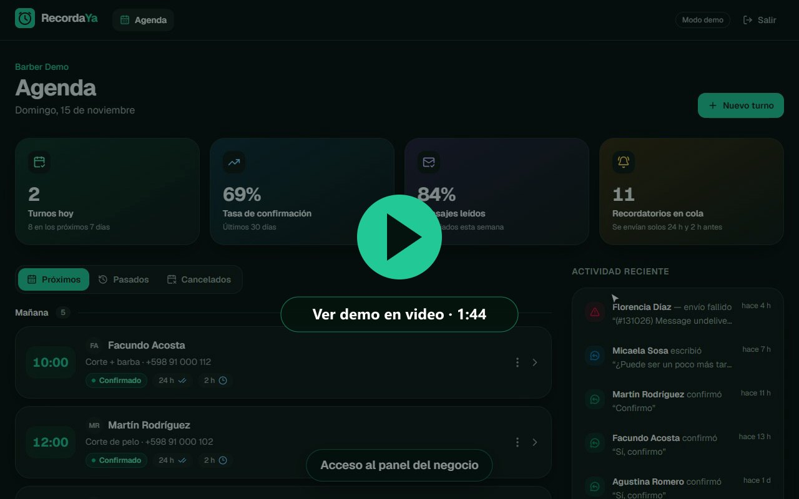
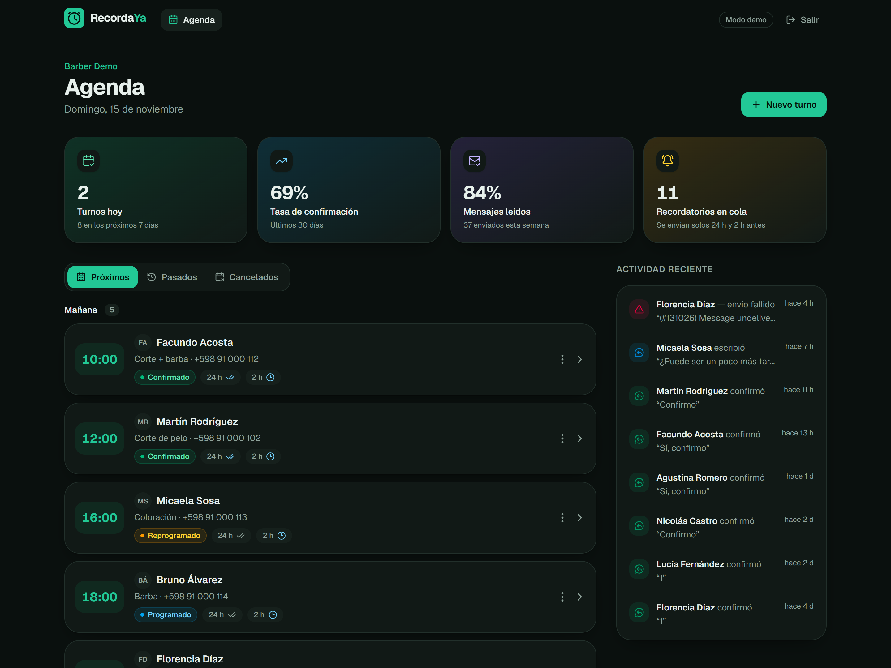
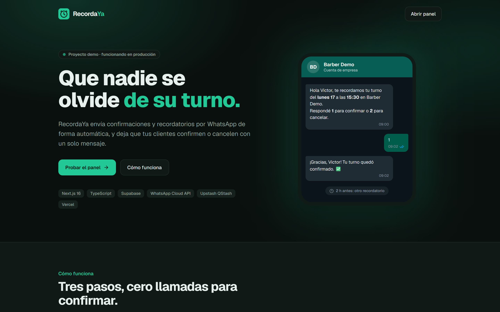
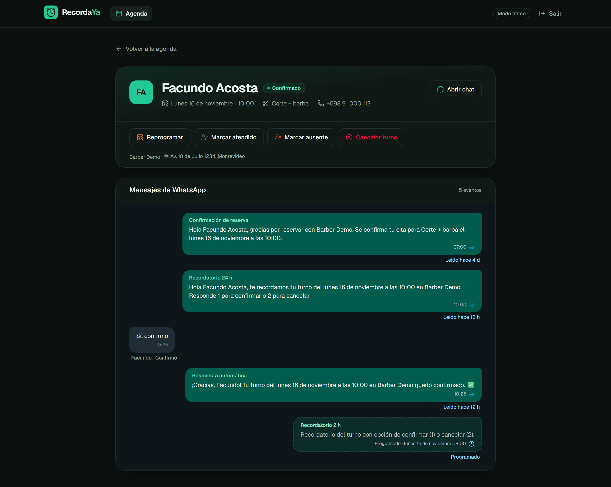
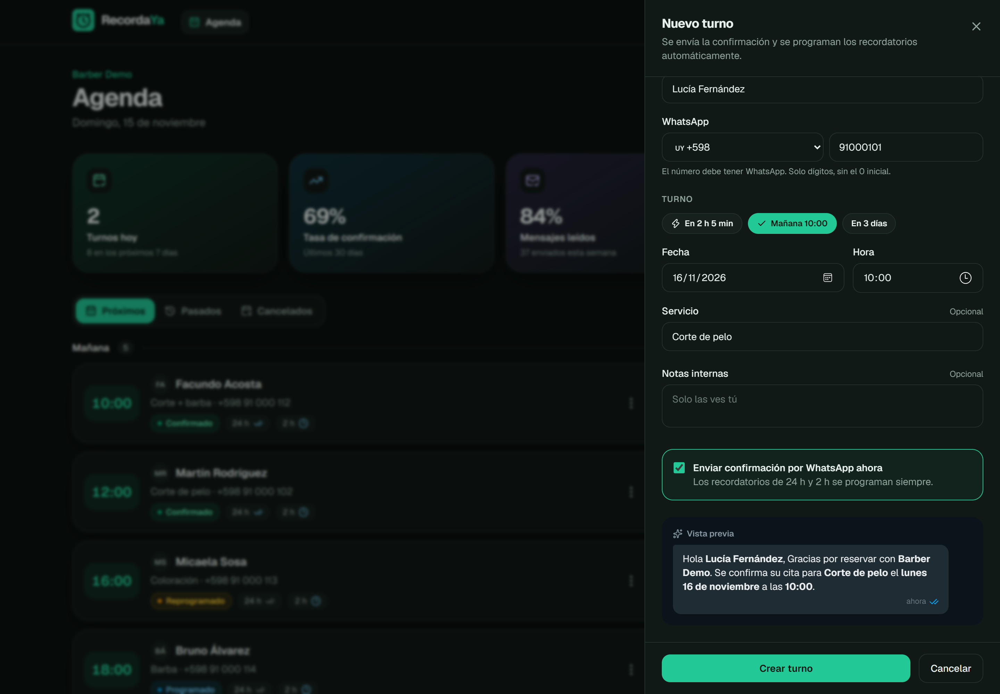
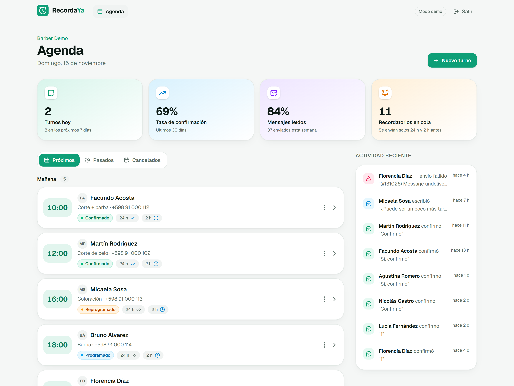
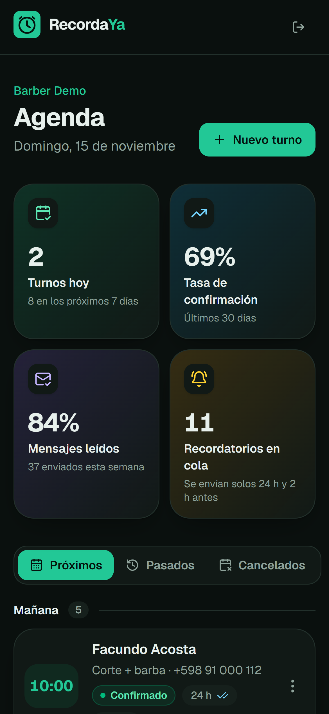
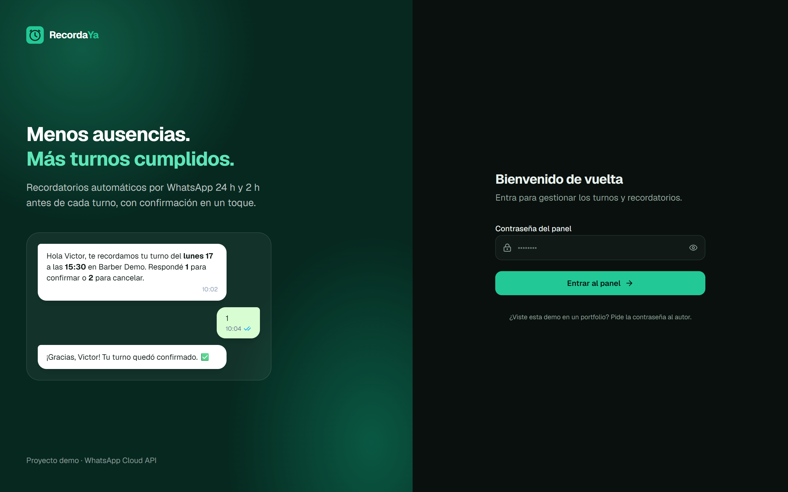

# RecordaYa

Recordatorios de turnos por WhatsApp para negocios: envío automático 24 h y 2 h antes de cada turno, seguimiento de entregas y lecturas, y respuestas de los clientes, usando la **WhatsApp Cloud API** oficial de Meta.

**🔗 Demo en vivo: [recordaya.vercel.app](https://recordaya.vercel.app)**

> Proyecto de portfolio, funcionando en producción con WhatsApp real. El panel está protegido con contraseña: si quieres probarlo, pídemela. Los turnos que se ven son datos de demostración con números ficticios.

### ▶ Video demo (1:44)

[](docs/demo/recordaya-demo.mp4)

Recorrido completo: landing, acceso al panel, alta de un turno con vista previa del mensaje, respuesta «1» del cliente que lo confirma solo y la conversación con estados de entrega y lectura.

## Capturas



| Landing | Detalle del turno con la conversación de WhatsApp |
| --- | --- |
|  |  |
| **Nuevo turno con vista previa del mensaje** | **Modo claro** |
|  |  |

<p align="center">
  
  &nbsp;&nbsp;
  
</p>

## Qué hace

1. **Cargas el turno** en el panel: el cliente recibe la confirmación por WhatsApp al instante.
2. **Se recuerda solo:** 24 h y 2 h antes sale un recordatorio automático (Upstash QStash).
3. **El cliente responde** «1» para confirmar o «2» para cancelar, y la agenda se actualiza sola. El panel muestra cada mensaje con su estado real: enviado, entregado (✓✓) o leído (✓✓ azul).

## Stack

- **Next.js 16** (App Router) + **TypeScript**
- **Supabase** (PostgreSQL)
- **WhatsApp Cloud API** (Graph API v26.0) con plantillas aprobadas
- **Upstash QStash** (envíos programados)
- **Vercel** (deploy) · producción: https://recordaya.vercel.app
- **Tailwind CSS 4** + lucide-react (panel web)

## Arquitectura

```
src/
├── app/api/
│   ├── appointments/route.ts       # POST: crea turno + programa recordatorios
│   ├── appointments/[id]/route.ts  # GET: turno + mensajes · PATCH: confirmar/cancelar/reprogramar
│   ├── jobs/send-reminder/route.ts # POST (QStash): envía un recordatorio a su hora
│   ├── jobs/dispatch/route.ts      # POST (QStash cron): programa los pendientes lejanos
│   ├── messages/test/route.ts      # POST: envía un recordatorio de prueba
│   └── webhooks/whatsapp/route.ts  # GET: verificación · POST: estados y respuestas
└── lib/
    ├── env.ts                      # variables de entorno validadas
    ├── dates.ts                    # formato de fecha/hora en la zona del negocio
    ├── http.ts                     # helpers de respuestas
    ├── auth/admin-key.ts           # protección de endpoints internos
    ├── supabase/admin.ts           # cliente de Supabase (solo servidor)
    ├── scheduler/qstash.ts         # programar / cancelar envíos + verificar firma
    ├── appointments/
    │   ├── reminders.ts            # plan 24 h / 2 h, cancelación y envío
    │   └── notify.ts               # avisos inmediatos (confirmación, cancelación)
    └── whatsapp/
        ├── client.ts               # sendTemplate() → Cloud API
        ├── templates.ts            # nombres y variables de plantillas
        ├── webhook.ts              # firma HMAC + tipos del payload
        └── process-webhook.ts      # actualiza estados y guarda respuestas
supabase/migrations/               # esquema de la base de datos (0001, 0002…)
```

**Flujo de un mensaje:** la app envía la plantilla → Meta devuelve un `wamid` → se guarda en `messages` → Meta notifica por webhook `sent → delivered → read` (o `failed`) → se actualiza el estado.

**Flujo de un recordatorio:** se crea el turno → se insertan los recordatorios `reminder_24h` y `reminder_2h` como `queued` → QStash los guarda con `notBefore` → a la hora indicada llama a `/api/jobs/send-reminder` (con firma) → si el turno sigue activo, se envía la plantilla (la de "confirmado" si el cliente ya confirmó). Cancelar o reprogramar el turno borra los envíos pendientes en QStash. Los recordatorios que caen más allá de la demora máxima del plan quedan sin programar hasta que `/api/jobs/dispatch` (cron horario) los agenda.

## Puesta en marcha

### 1. Variables de entorno

```bash
cp .env.example .env.local
```

Completa `.env.local` (ver comentarios en `.env.example`).

### 2. Base de datos

En Supabase → **SQL Editor**, pega y ejecuta en orden los archivos de `supabase/migrations/` (`0001_init.sql`, `0002_reminders.sql`, `0003_service_role_grants.sql`, `0004_customer_replies.sql`). Las migraciones del chatbot (`0005` a `0011`, aditivas) se aplican igual y cada una tiene su reversión en `supabase/migrations/down/`; el chatbot requiere pgvector (`create extension vector`).

### 3. Ejecutar

```bash
npm install
npm run dev
```

### 4. Probar un envío

PowerShell:

```powershell
$headers = @{ Authorization = "Bearer TU_ADMIN_API_KEY" }
$body = @{
  to      = "59899123456"
  nombre  = "Victor"
  fecha   = "lunes 17 de noviembre"
  hora    = "15:30"
  negocio = "Barbería Centro"
} | ConvertTo-Json

Invoke-RestMethod -Method Post -Uri http://localhost:3000/api/messages/test `
  -Headers $headers -ContentType "application/json; charset=utf-8" -Body $body
```

### 5. Webhook (estados de entrega y respuestas)

Meta necesita una URL pública. En desarrollo usa un túnel:

```bash
npx cloudflared tunnel --url http://localhost:3000
```

En **Meta for Developers → tu app → WhatsApp → Configuración → Webhook**:

- URL de devolución de llamada: `https://<tu-tunel>/api/webhooks/whatsapp`
- Token de verificación: el valor de `WHATSAPP_WEBHOOK_VERIFY_TOKEN`
- Suscribirse al campo **messages**

`WHATSAPP_APP_SECRET` (Meta for Developers → Configuración de la app → Básica → Clave secreta) es obligatorio: sin él, el webhook rechaza todos los eventos por firma inválida.

Con el webhook activo, el cliente puede responder al recordatorio:

| Respuesta | Efecto |
| --- | --- |
| `1`, `sí`, `confirmo`… | El turno pasa a `confirmed` y se le contesta confirmando. Los recordatorios siguientes usan la plantilla de "turno confirmado". |
| `2`, `no`, `cancelar`… | Se cancelan los recordatorios pendientes, el turno pasa a `cancelled` y se envía la plantilla de cancelación. |
| Otra cosa | Se le recuerda su próximo turno y las opciones 1 / 2. |

El turno se identifica por el mensaje citado (si responde a uno) o, si no, por su próximo turno activo.

### 6. Turnos y recordatorios programados

1. QStash:
   - **Desarrollo:** `QSTASH_DEV=true` y `APP_URL=http://localhost:3000`. El SDK arranca un QStash local, sin cuenta ni túnel.
   - **Producción:** en [Upstash Console](https://console.upstash.com) → **QStash**, copia el token y las dos signing keys, `QSTASH_DEV=false` y `APP_URL` con la URL pública.
2. Crea un negocio en Supabase (SQL Editor):

   ```sql
   insert into businesses (name, address) values ('Barbería Centro', 'Av. 18 de Julio 1234') returning id;
   ```

3. Crea un turno (PowerShell):

   ```powershell
   $headers = @{ Authorization = "Bearer TU_ADMIN_API_KEY" }
   $body = @{
     business_id = "UUID_DEL_NEGOCIO"
     customer    = @{ name = "Victor"; phone = "59899123456" }
     starts_at   = "2026-11-17T15:30:00-03:00"
     service     = "Corte de pelo"
   } | ConvertTo-Json

   Invoke-RestMethod -Method Post -Uri http://localhost:3000/api/appointments `
     -Headers $headers -ContentType "application/json; charset=utf-8" -Body $body
   ```

   Responde con el turno, los recordatorios programados y el resultado de la confirmación (`"notify": false` para no enviarla).

4. Cancelar o reprogramar:

   ```powershell
   Invoke-RestMethod -Method Patch -Uri http://localhost:3000/api/appointments/UUID_DEL_TURNO `
     -Headers $headers -ContentType "application/json; charset=utf-8" -Body '{"status":"cancelled"}'
   # o: -Body '{"starts_at":"2026-11-18T10:00:00-03:00"}'
   ```

5. (Opcional) En QStash → **Schedules**, crea uno con destino `APP_URL/api/jobs/dispatch` y cron `0 * * * *`.

## Entornos: desarrollo y producción

| | Local (`npm run dev`) | Producción (Vercel) |
| --- | --- | --- |
| Base de datos | Proyecto Supabase **recordaya-dev** | Proyecto Supabase **RecordaYA** |
| Variables | `.env.local` | Environment Variables de Vercel |
| QStash | Servidor local (`QSTASH_DEV=true`) | Upstash QStash (integración de Vercel) |
| Webhook de Meta | — | `https://recordaya.vercel.app/api/webhooks/whatsapp` |

Las pruebas locales no tocan los datos de producción. Para crear la base de desarrollo, ejecuta las migraciones de `supabase/migrations/` en un segundo proyecto de Supabase y pon su URL y secret key en `.env.local`.

**Respuestas de clientes en local:** Meta solo admite un webhook, que apunta a producción, así que las respuestas reales desde WhatsApp nunca llegan al servidor local. Para probar confirmar o cancelar en local, simúlalas (el evento va firmado con `WHATSAPP_APP_SECRET`, igual que los de Meta):

```bash
npm run simulate:reply -- 59899123456 1
npm run simulate:reply -- 59899123456 "No puedo, cancelo"
```

Con el chatbot activo (ver `CHATBOT_ENABLED` y el panel `/panel/chatbot`) el script reproduce todos los casos del enrutamiento de mensajes. Para que el chatbot responda, el `phone_number_id` debe coincidir con `businesses.wa_phone_number_id` del negocio:

```bash
# Responder citando un recordatorio (el wamid sale de la tabla messages)
npm run simulate:reply -- 59899123456 "1" --context wamid.XXXX
# Tocar un botón de derivación a una persona
npm run simulate:reply -- 59899123456 "Sí, con una persona" --button handoff:yes
# Audio, imagen u otro contenido que no es texto
npm run simulate:reply -- 59899123456 --type audio
# Otro número de WhatsApp Business o nombre de perfil
npm run simulate:reply -- 59899123456 "hola" --phone-number-id 123456789 --name "María"
```

**Datos de demostración:** para llenar el panel con 20 turnos de ejemplo (pasados, de hoy y próximos, con mensajes, estados y respuestas), sin enviar ningún WhatsApp:

```bash
npm run seed:demo -- --reset --backup backups --yes
```

`--reset` borra turnos, clientes y mensajes (conserva los negocios) y `--backup` guarda antes un JSON en `backups/` (ignorado por git). Usa `.env.local`, es decir, la base de desarrollo.

Ojo: los envíos de WhatsApp desde local son reales. Con el número de prueba de Meta solo llegan a los destinatarios autorizados; con un número ficticio el envío falla y queda registrado como `failed`.

## Panel web

- `/` — landing pública del proyecto.
- `/login` — acceso con `PANEL_PASSWORD` (cookie de sesión firmada con HMAC, 7 días).
- `/panel` — agenda por día (próximos, pasados, cancelados), métricas, actividad reciente y alta de turnos con vista previa del mensaje de WhatsApp.
- `/panel/turnos/:id` — detalle con la conversación (mensajes enviados con ✓/✓✓/leído y respuestas del cliente) y acciones: confirmar, reprogramar, atendido, ausente y cancelar.

Las páginas leen Supabase en el servidor (Server Components dentro de `<Suspense>`, compatible con Cache Components) y las acciones son Server Actions que verifican la sesión. La API (`/api/appointments`) y el panel comparten la misma lógica (`src/lib/appointments/service.ts`).

### Chatbot y atención humana

Con `CHATBOT_ENABLED=true` y un negocio con el chatbot activado (`/panel/chatbot`), los mensajes que no son respuestas a recordatorios los contesta un asistente con IA; si no sabe, o el cliente lo pide, la conversación pasa a una persona del equipo.

- `/panel/conversaciones` — bandeja (pendientes, mías, IA, todas, cerradas), con búsqueda y filtros; el detalle muestra el historial completo, el motivo de la derivación, el resumen y el compositor (solo el asignado, dentro de la ventana de 24 h de WhatsApp).
- `/panel/conocimiento` — fuentes del asistente (preguntas frecuentes, textos, archivos, páginas web) y preguntas que no supo responder.
- `/panel/chatbot` — configuración, `/panel/chatbot/pruebas` (probar sin enviar nada) y `/panel/chatbot/metricas`.
- `/panel/equipo` — invitar y gestionar al equipo (roles owner, admin y operador).

Para producción hay que programar en QStash el mantenimiento de conversaciones (cierra por inactividad, apaga la disponibilidad de quien dejó el panel y re-encola mensajes sin respuesta). Se puede disparar a mano con la clave de administración:

```bash
curl -X POST https://TU-DOMINIO/api/jobs/conversations-maintenance -H "Authorization: Bearer $ADMIN_API_KEY"
```

Schedule sugerido: cada 10 minutos (`*/10 * * * *`) apuntando a esa URL.

## Deploy en Vercel

1. Importa el repo en Vercel (preset Next.js).
2. En **Environment Variables** pega las variables de `.env.example` con valores de producción (`QSTASH_DEV=false`, sin `APP_URL`: se toma la URL de producción de Vercel).
3. En **Integrations** agrega **Upstash QStash** (plan Free): crea `QSTASH_TOKEN`, `QSTASH_URL` y las dos signing keys automáticamente.
4. En Meta, cambia la URL del webhook a `https://<tu-proyecto>.vercel.app/api/webhooks/whatsapp` (hay que volver a escribir el token de verificación).
5. Publica la app de Meta (requiere `/privacidad` y `/eliminacion-de-datos`) y suscribe la app a tu cuenta de WhatsApp Business; sin esto, los mensajes reales no llegan al webhook:

   ```bash
   curl -X POST "https://graph.facebook.com/v26.0/$WHATSAPP_BUSINESS_ACCOUNT_ID/subscribed_apps" \
     -H "Authorization: Bearer $WHATSAPP_ACCESS_TOKEN"
   ```

Cada push a `main` despliega automáticamente.

## Roadmap

- [x] Envío de plantillas por Cloud API
- [x] Webhook con verificación de firma y estados de mensajes
- [x] Esquema de base de datos
- [x] Programación de recordatorios 24 h / 2 h (QStash)
- [x] Confirmar / cancelar respondiendo 1 / 2
- [ ] Reprogramar desde WhatsApp
- [x] Panel web: agenda, historial de mensajes y métricas
- [ ] Panel: listado de clientes
- [ ] Login multi-negocio
- [x] Deploy en Vercel
- [x] Publicar la app de Meta (eventos reales: entregado, leído, respuestas)
- [x] Demo pública con datos de ejemplo (`npm run seed:demo`)
