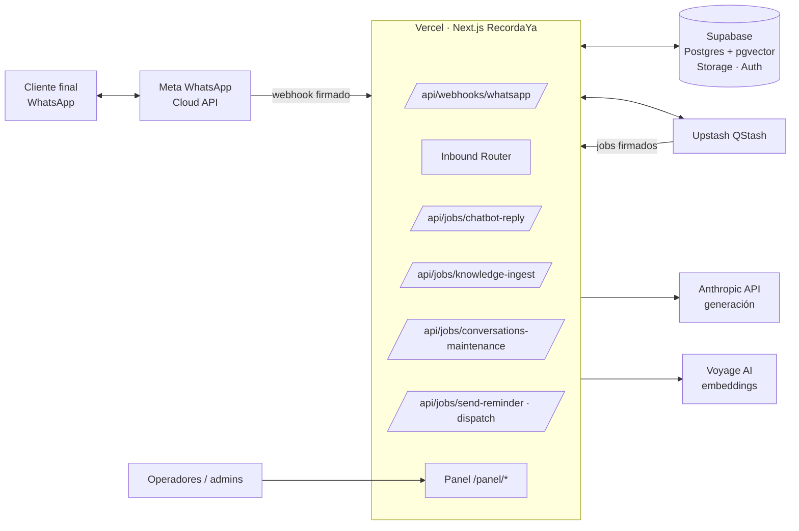
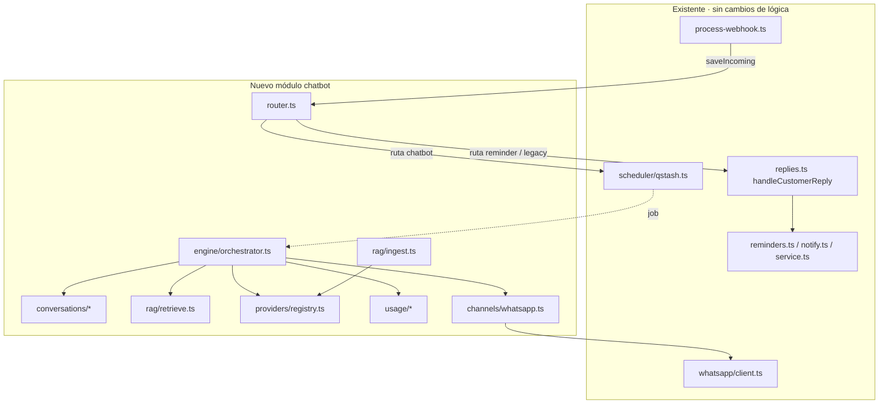
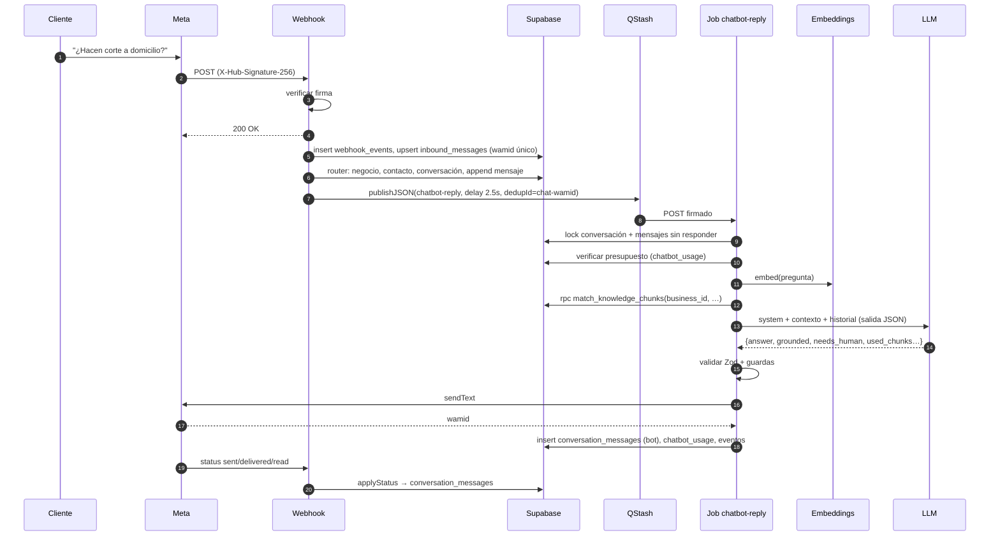
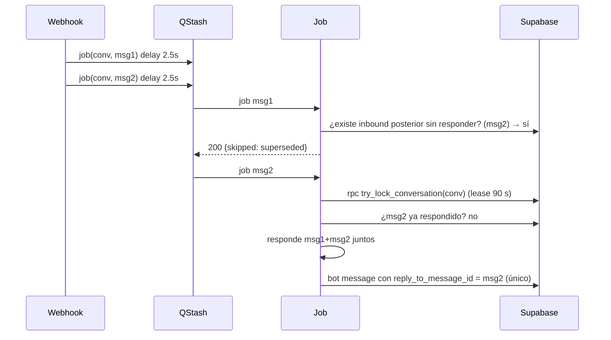
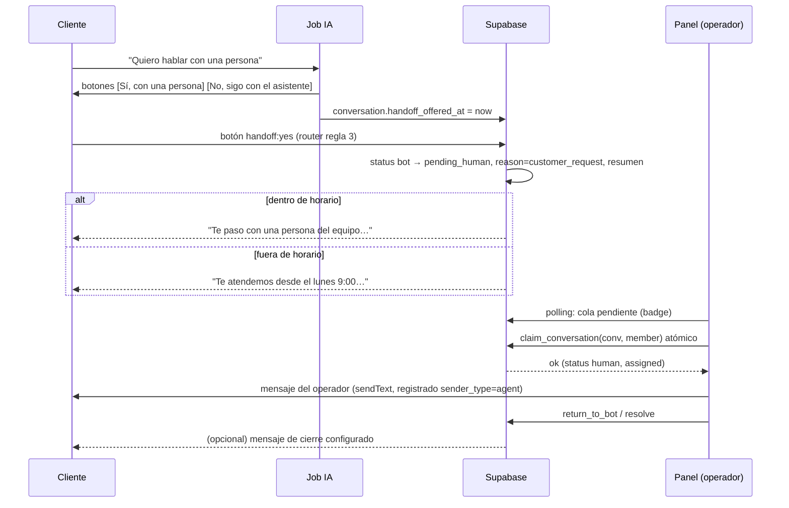
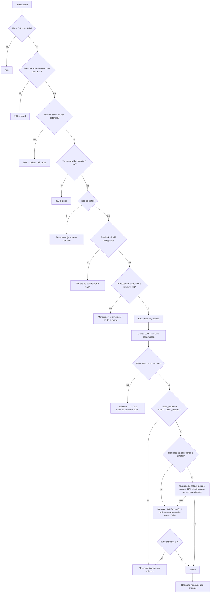
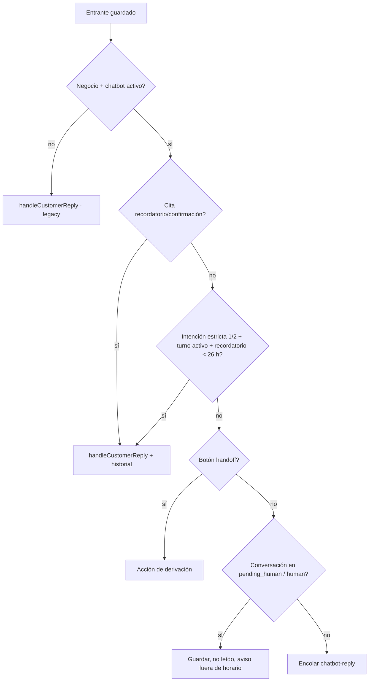

# 02 · Arquitectura, diagramas e integración con Meta

[← Índice](RECORDAYA_CHATBOT_TECHNICAL_SPECIFICATION.md)

Todo este documento es **[PROPUESTA]**, salvo donde se indique **[HECHO]**.

---

## 7. Arquitectura propuesta

### 7.1 Principios

1. **Un solo sistema.** Misma app Next.js, mismo proyecto Supabase, mismo número y webhook de WhatsApp, mismo QStash, mismo panel.
2. **Router delante, lógica actual intacta.** El único cambio en el camino de los recordatorios es *quién* llama a `handleCustomerReply`; la función no se modifica.
3. **El webhook no piensa.** Guarda, decide la ruta con consultas baratas y encola. La IA corre en un job con reintentos.
4. **Proveedores intercambiables.** `LlmProvider` y `EmbeddingProvider` son interfaces; los SDK solo se importan en `src/lib/chatbot/providers/`.
5. **`business_id` siempre explícito.** Toda función del módulo recibe `businessId` y toda consulta lo filtra.
6. **Fallar hacia el humano.** Ante errores, falta de información o tope de gasto, el sistema ofrece una persona; nunca inventa ni queda en silencio.

### 7.2 Módulos

| Módulo | Responsabilidad | Ubicación |
| --- | --- | --- |
| Inbound Router | Decide `reminder` / `human` / `chatbot` / `legacy` para cada entrante | `src/lib/chatbot/router.ts` |
| Conversations | Contactos, conversaciones, mensajes, máquina de estados, eventos | `src/lib/chatbot/conversations/` |
| Engine | Orquesta un turno de IA: contexto, recuperación, llamada, validación, guardas, envío | `src/lib/chatbot/engine/` |
| RAG | Extracción, fragmentación, embeddings, ingesta, recuperación | `src/lib/chatbot/rag/` |
| Providers | Adaptadores de IA (Anthropic, Voyage; otros opcionales) | `src/lib/chatbot/providers/` |
| Handoff | Oferta, confirmación, cola, toma, horarios humanos | `src/lib/chatbot/conversations/handoff.ts`, `hours.ts` |
| Usage | Medición de tokens y costos, topes | `src/lib/chatbot/usage/` |
| Channels | Envío por canal (WhatsApp ahora, web en fase 2) | `src/lib/chatbot/channels/` |
| Auth/Members | Sesión Supabase, membresías, permisos | `src/lib/auth/` |
| Panel UI | Páginas y Server Actions nuevas | `src/app/panel/{conversaciones,conocimiento,chatbot,equipo}/` |
| Jobs | `chatbot-reply`, `knowledge-ingest`, `conversations-maintenance` | `src/app/api/jobs/*` |

---

## 8. Diagramas de arquitectura

### 8.1 Contexto



### 8.2 Componentes internos



### 8.3 Despliegue

Igual que hoy: un proyecto Vercel (deploy en push a `main`), dos proyectos Supabase (`recordaya-dev`, `RecordaYA`), QStash vía integración de Vercel. Nuevos: claves de Anthropic y Voyage en *Environment Variables*, bucket privado `knowledge` en Supabase Storage, extensión `vector`, schedule de QStash para mantenimiento.

---

## 5. Enrutamiento de mensajes entrantes (recordatorios vs. chatbot)

### 5.1 Reglas (evaluadas en orden; la primera que aplica gana)

| # | Condición | Ruta | Qué ocurre |
| --- | --- | --- | --- |
| 0 | No se puede resolver el negocio, **o** el negocio no tiene chatbot activo, **o** `CHATBOT_ENABLED=false` (kill switch), **o** `CHATBOT_ALLOWLIST_PHONES` está definida y no incluye el teléfono | `legacy` | `handleCustomerReply(...)` exactamente como hoy |
| 1 | El mensaje **cita** (`context.id`) un mensaje de `messages` cuyo `kind` es `reminder_24h`, `reminder_2h`, `confirmation` o `reschedule` | `reminder` | `handleCustomerReply(...)` como hoy (parser actual). Se agrega una copia al historial de la conversación con `sender_type='customer'` y un evento `reminder_reply_routed` |
| 2 | `parseStrictReplyIntent(text) ∈ {confirm, cancel}` **y** el contacto tiene un turno activo futuro **y** se le envió un recordatorio/confirmación en las últimas 26 h (`messages.sent_at`) | `reminder` | Igual que 1 |
| 3 | Botón interactivo con id `handoff:yes` / `handoff:no` | `chatbot` (acción determinística) | Se confirma o cancela la derivación sin IA |
| 4 | La conversación abierta está en `pending_human` o `human` | `human` | Se guarda el mensaje, `unread_count++`, se actualiza `last_inbound_at`; **sin respuesta automática** (salvo el aviso de fuera de horario, una vez cada 12 h, si está `pending_human`) |
| 5 | Resto | `chatbot` | Se guarda y se encola `chatbot-reply` |

Definición del parser estricto (archivo nuevo `src/lib/chatbot/strict-intent.ts`, **no** modifica `intent.ts`): normaliza igual que `parseReplyIntent`; devuelve `confirm`/`cancel` solo si el mensaje completo tiene ≤ 3 palabras y **todas** pertenecen al vocabulario (`1, si, confirmo, confirmar, confirmado, ok, dale, voy, gracias` / `2, no, cancelo, cancelar, cancelado, cancela, puedo`) y no hay otra intención mezclada; en otro caso `unknown`. Ejemplos: «1» → confirm; «Sí, confirmo» → confirm; «2» → cancel; «no puedo» → cancel; «No sé si abren el sábado» → unknown (va al chatbot); «1 pregunta: ¿aceptan tarjeta?» → unknown.

### 5.2 Pseudocódigo del router

```ts
// src/lib/chatbot/router.ts
export async function routeInboundMessage(input: InboundContext): Promise<RouteResult> {
  const business = await resolveBusiness(input.phoneNumberId);           // businesses.wa_phone_number_id o negocio único
  const settings = business && await getChatbotSettings(business.id);   // null si no hay fila
  if (!business || !settings?.enabled || !isChatbotGloballyEnabled()) {
    await handleCustomerReply(legacyInput(input));                      // RUTA 0: comportamiento actual
    return { route: "legacy" };
  }

  const contact = await upsertContact(business.id, input.from, input.profileName);
  const conversation = await getOrOpenConversation(business.id, contact.id, "whatsapp");
  const message = await appendInbound(conversation, input);              // idempotente por inbound_message_id

  const quoted = input.replyTo ? await findOwnMessage(input.replyTo) : null;
  if (quoted?.source === "messages" && REMINDER_KINDS.includes(quoted.kind)) {
    await handleCustomerReply(legacyInput(input));                      // RUTA 1
    await logEvent(conversation, "reminder_reply_routed", { quoted: quoted.id });
    return { route: "reminder" };
  }
  if (parseStrictReplyIntent(input.text) !== "unknown"
      && await hasRecentReminderForActiveAppointment(business.id, input.from, 26 * HOUR_MS)) {
    await handleCustomerReply(legacyInput(input));                      // RUTA 2
    await logEvent(conversation, "reminder_reply_routed", { strict: true });
    return { route: "reminder" };
  }
  if (input.buttonId?.startsWith("handoff:")) {
    await handleHandoffButton(conversation, input.buttonId);            // RUTA 3
    return { route: "chatbot" };
  }
  if (conversation.status === "pending_human" || conversation.status === "human") {
    await markUnread(conversation);                                     // RUTA 4
    await maybeSendOutOfHoursNotice(conversation, settings);
    return { route: "human" };
  }
  await enqueueChatbotReply(conversation.id, message.id, input.waMessageId);   // RUTA 5
  return { route: "chatbot" };
}
```

`saveIncoming()` queda así (único cambio en ese archivo además de `applyStatus`):

```diff
-  await handleCustomerReply({ inboundId, fromPhone, text, replyTo });
+  await routeInboundMessage({
+    inboundId: inserted.id, waMessageId: message.id, from: message.from,
+    text: incomingText(message), replyTo: message.context?.id ?? null,
+    buttonId: message.interactive?.button_reply?.id ?? null,
+    type: message.type, phoneNumberId: metadata.phone_number_id,
+    profileName: contacts?.find(c => c.wa_id === message.from)?.profile.name ?? null,
+    receivedAt,
+  });
```

### 5.3 Por qué un parser estricto solo con chatbot activo

- Con el chatbot **desactivado** el cliente solo puede hacer dos cosas (confirmar/cancelar); el parser laxo es razonable y **no se toca**.
- Con el chatbot **activo** se invita a conversar; frases naturales que empiezan por «no» o «sí» son frecuentes y no deben cancelar/confirmar turnos. Las respuestas que **citan** un recordatorio siguen usando el parser actual, porque el contexto es inequívoco.
- Es la única diferencia de comportamiento sobre recordatorios y está detrás del interruptor del negocio (D-06).

### 5.4 Casos límite

| Caso | Resultado |
| --- | --- |
| Cliente recibe recordatorio y responde «1» sin citar | Regla 2 → confirma (si hubo recordatorio < 26 h) |
| Cliente cita el recordatorio y escribe «¿Puedo llevar a mi hijo?» | Regla 1 → `handleCustomerReply` con intención `unknown` → responde «Responde 1 o 2» (comportamiento actual). **Además** se encola el chatbot para la pregunta ([PROPUESTA] opción configurable `answer_questions_on_reminder_replies`, por defecto `true`): el cliente recibe el aviso 1/2 y la respuesta. Si se prefiere una sola respuesta, desactivar la opción |
| Cliente en atención humana responde «2» citando un recordatorio | Regla 1 → cancela el turno; el operador ve el evento en el historial |
| Cliente sin turno escribe «1» | Regla 2 no aplica (sin turno) → chatbot |
| Cliente escribe «Hola» por primera vez | Chatbot → bienvenida configurada + respuesta |
| Dos mensajes seguidos en 2 s | Un solo job (agrupación, §9.2) responde a ambos |
| Audio/imagen | Chatbot → respuesta determinística "no puedo procesar audios" + oferta de humano (sin llamada a IA) |
| Mensaje de un número de otro negocio (multi-número) | Se resuelve por `metadata.phone_number_id` |

---

## 9. Diagramas de secuencia

### 9.1 Pregunta respondida por la IA (WhatsApp)



### 9.2 Agrupación de ráfagas e idempotencia del job



### 9.3 Derivación a humano



### 9.4 Ingesta de un documento

```mermaid
sequenceDiagram
  participant A as Admin
  participant P as Server Action
  participant S as Storage
  participant Q as QStash
  participant J as Job knowledge-ingest
  participant E as Embeddings
  participant DB as Supabase
  A->>P: requestUploadUrl(nombre, tipo, tamaño)
  P->>DB: insert knowledge_sources(pending) + knowledge_documents(v1, pending)
  P-->>A: signed upload URL (bucket privado)
  A->>S: PUT archivo
  A->>P: confirmUpload(sourceId)
  P->>Q: publish knowledge-ingest(documentId)
  Q->>J: POST firmado
  J->>S: descargar, validar magic bytes y tamaño
  J->>J: extraer texto → normalizar → fragmentar
  J->>E: embed(lotes de 64)
  J->>DB: insert knowledge_chunks (documento v1)
  J->>DB: tx: source.active_document_id = v1, status ready; borrar chunks de versión anterior
```

---

## 10. Diagramas de flujo

### 10.1 Turno de IA (engine)



### 10.2 Enrutamiento de un entrante

Ver tabla §5.1; diagrama:



---

## 17. Integración con Meta

### 17.1 Mismo número

**Decisión: usar el mismo número.** Motivos: los clientes ya conocen el número por los recordatorios; Meta admite un único webhook por app [HECHO por README]; un segundo número exige otra verificación y otra calidad de número. El router resuelve los conflictos.

### 17.2 Identificación

| Elemento | Origen | Uso |
| --- | --- | --- |
| Negocio | `value.metadata.phone_number_id` → `businesses.wa_phone_number_id`; si ningún negocio lo tiene asignado y existe **exactamente uno** con chatbot activo, ese (compatibilidad) | Aislamiento |
| Contacto | `message.from` (wa_id, solo dígitos) → `chat_contacts (business_id, channel, external_id)`; nombre de `contacts[].profile.name` | Historial |
| Cliente de turnos | `customers` con mismo `business_id` y `phone` → `chat_contacts.customer_id` | Contexto de turno |
| Conversación | Abierta (`status <> 'closed'`) por `(business_id, contact_id, channel)`, índice único parcial | Estado |
| Mensaje | `wamid` (`inbound_messages.wa_message_id` / `conversation_messages.wa_message_id`) | Idempotencia y estados |

### 17.3 Envíos

- Respuestas del bot y de operadores: `sendText()` existente (texto libre) dentro de la ventana de atención de 24 h desde el último mensaje del cliente (`conversations.last_inbound_at`).
- Botones de derivación: nuevo `sendInteractiveButtons(to, body, buttons[≤3])` (`type: "interactive"`, `interactive.type: "button"`, títulos ≤ 20 caracteres, ids `handoff:yes`/`handoff:no`). [PENDIENTE] validar contra la documentación vigente de la Cloud API antes de implementar.
- Fuera de 24 h: el operador no puede enviar texto libre; el panel ofrece la plantilla `retomar_conversacion` (D-08). El bot nunca inicia conversaciones.
- Los mensajes salientes del chatbot **no** se guardan en `messages` (para no alterar métricas de recordatorios: "Enviados 7 días", "Tasa de lectura"), sino en `conversation_messages`.

### 17.4 Errores y reintentos

| Error | Origen | Tratamiento |
| --- | --- | --- |
| Firma inválida | Webhook | 401 (como hoy) |
| Excepción al procesar | `after()` | Se registra; el entrante ya está guardado. El job de mantenimiento detecta entrantes de conversaciones `bot` sin respuesta > 2 min y los re-encola (red de seguridad) |
| 5xx / red de Graph API | Job | Lanzar ⇒ 500 ⇒ QStash reintenta (3 veces, *backoff*). El `reply_to_message_id` único evita duplicados si el envío salió pero falló el guardado: antes de enviar se inserta la fila `queued` y se actualiza tras el envío |
| 4xx de Graph API | Job | Marcar `failed` con `error`, no reintentar, evento `send_failed` |
| Fuera de ventana (re-engagement) | Graph API [PENDIENTE código exacto, documentado como 131047] | `failed` + aviso al operador para usar plantilla |
| Límite por destinatario / throughput [PENDIENTE códigos 131056, 130429] | Graph API | Reintento con demora vía QStash (`delay`) |
| Error del proveedor de IA | Job | Reintento interno 1 vez; luego mensaje "sin información" + oferta humano |

### 17.5 Límites de Meta a considerar [PENDIENTE verificar valores vigentes]

- Throughput por número (por defecto del orden de decenas de mensajes por segundo); irrelevante a la escala prevista.
- Límite de mensajes por destinatario en ventanas cortas: el agrupamiento de ráfagas reduce envíos consecutivos.
- Límite de conversaciones iniciadas por el negocio (tier de mensajería): aplica a plantillas (recordatorios), no a respuestas de servicio.
- Las respuestas libres dentro de la ventana de atención no requieren plantilla.

### 17.6 Sin cambios en Meta

No se modifica la configuración de la app ni del webhook. Solo se **agrega** (cuando se apruebe D-08) una plantilla nueva en WhatsApp Manager. El campo suscrito sigue siendo `messages`.

---

## Widget web (fase 2)

**Decisión: fase 2.** Motivo: el canal donde ya están los clientes es WhatsApp; el widget agrega superficie pública (abuso, costos, CORS) que conviene abordar con el núcleo estable.

Diseño para la fase 2:

- Script `public/widget/v1.js` (≤ 20 KB, sin dependencias) que inyecta un iframe `https://<app>/widget/<publicKey>`; el iframe es una página Next.js propia (aislada del sitio anfitrión).
- `chatbot_settings.widget_public_key` (aleatoria, rotable) y `widget_allowed_origins text[]`; la página valida `document.referrer`/`Origin`.
- Sesión anónima: `POST /api/widget/v1/sessions` → token firmado (HMAC, 24 h) con `business_id` y `contact_id` (`chat_contacts.channel='web'`, `external_id` = uuid aleatorio en `localStorage`).
- Mensajes: `POST /api/widget/v1/messages` (encola el mismo job `chatbot-reply`, canal `web`), `GET /api/widget/v1/messages?after=<id>` (polling 3 s).
- Anti-abuso: rate limit por token e IP, Cloudflare Turnstile opcional al abrir, tope de mensajes por sesión, mismo presupuesto del negocio.
- Atención humana: igual; el operador responde desde la misma bandeja (canal "Web"), sin restricción de 24 h.
- `channels/web.ts` implementa la misma interfaz `ChannelSender` que `channels/whatsapp.ts`.

---

## Estructura de archivos propuesta

```
src/
├── lib/
│   ├── auth/
│   │   ├── admin-key.ts                 (existente, sin cambios)
│   │   ├── supabase-server.ts           NUEVO  cliente @supabase/ssr con cookies
│   │   ├── session.ts                   NUEVO  getCurrentMember(), requireMember(role)
│   │   └── permissions.ts               NUEVO  matriz de permisos
│   ├── chatbot/
│   │   ├── config.ts                    NUEVO  env del módulo (modelo, kill switch, límites)
│   │   ├── router.ts                    NUEVO
│   │   ├── strict-intent.ts             NUEVO
│   │   ├── settings.ts                  NUEVO  get/update chatbot_settings (+ Zod)
│   │   ├── panel-data.ts                NUEVO  DAL de lectura del panel
│   │   ├── conversations/
│   │   │   ├── contacts.ts              NUEVO
│   │   │   ├── service.ts               NUEVO  open/append/list
│   │   │   ├── state-machine.ts         NUEVO  transiciones válidas
│   │   │   ├── handoff.ts               NUEVO  offer/confirm/claim/release/return/resolve
│   │   │   ├── hours.ts                 NUEVO  ¿en horario? próximo horario
│   │   │   └── events.ts                NUEVO
│   │   ├── engine/
│   │   │   ├── orchestrator.ts          NUEVO  runChatbotTurn()
│   │   │   ├── prompt.ts                NUEVO  construcción de system/context
│   │   │   ├── schema.ts                NUEVO  Zod de la salida
│   │   │   ├── guardrails.ts            NUEVO  validaciones de entrada/salida
│   │   │   ├── smalltalk.ts             NUEVO  respuestas sin IA
│   │   │   └── summarize.ts             NUEVO  resumen para el operador
│   │   ├── rag/
│   │   │   ├── extract/{pdf,docx,txt,url,index}.ts   NUEVO
│   │   │   ├── normalize.ts, chunk.ts   NUEVO
│   │   │   ├── ingest.ts                NUEVO
│   │   │   ├── retrieve.ts              NUEVO
│   │   │   └── sources.ts               NUEVO  CRUD de fuentes
│   │   ├── providers/
│   │   │   ├── types.ts                 NUEVO  LlmProvider, EmbeddingProvider
│   │   │   ├── anthropic.ts             NUEVO
│   │   │   ├── voyage.ts                NUEVO
│   │   │   ├── fake.ts                  NUEVO  para pruebas
│   │   │   └── registry.ts              NUEVO
│   │   ├── usage/{meter,pricing,budget}.ts   NUEVO
│   │   ├── channels/{types,whatsapp,web}.ts  NUEVO (web en fase 2)
│   │   └── jobs.ts                      NUEVO  enqueue helpers
│   ├── logger.ts                        NUEVO  log JSON con enmascarado
│   ├── scheduler/qstash.ts              MODIFICADO (+ publishJob)
│   ├── whatsapp/client.ts               MODIFICADO (+ sendInteractiveButtons)
│   ├── whatsapp/webhook.ts              MODIFICADO (tipos)
│   └── whatsapp/process-webhook.ts      MODIFICADO (router + applyStatus)
├── app/
│   ├── api/jobs/chatbot-reply/route.ts            NUEVO
│   ├── api/jobs/knowledge-ingest/route.ts         NUEVO
│   ├── api/jobs/conversations-maintenance/route.ts NUEVO
│   ├── api/panel/inbox/route.ts                   NUEVO  polling (sesión)
│   ├── auth/callback/route.ts                     NUEVO  Supabase Auth
│   ├── login/*                                    MODIFICADO
│   └── panel/
│       ├── layout.tsx                             MODIFICADO (nav)
│       ├── conversaciones/{page,[id]/page,actions}.tsx   NUEVO
│       ├── conocimiento/{page,[id]/page,actions}.tsx     NUEVO
│       ├── chatbot/{page,metricas/page,pruebas/page,actions}.tsx NUEVO
│       └── equipo/{page,actions}.tsx                     NUEVO
supabase/migrations/0005 … 0011 + supabase/migrations/down/*.sql   NUEVO
tests/ (unit, integration, ai-evals)                                 NUEVO
.github/workflows/ci.yml                                             NUEVO
vitest.config.ts                                                     NUEVO
```
