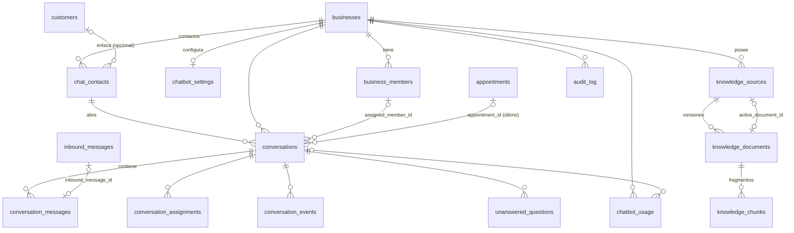

# 03 · Modelo de datos, diccionario y migraciones

[← Índice](RECORDAYA_CHATBOT_TECHNICAL_SPECIFICATION.md)

Todo es **[PROPUESTA]**. Convenciones heredadas de `0001_init.sql` [HECHO]: tablas en plural `snake_case`, `uuid` con `gen_random_uuid()`, `timestamptz`, `created_at/updated_at` con trigger `set_updated_at()`, `enum` de Postgres para estados, RLS activado. Los nombres orientativos del encargo se adaptaron así:

| Nombre orientativo | Nombre final | Motivo |
| --- | --- | --- |
| chatbot_settings | `chatbot_settings` | — |
| knowledge_sources | `knowledge_sources` | Ítem lógico (FAQ, texto, archivo, URL) |
| knowledge_documents | `knowledge_documents` | **Versión** procesada de una fuente (permite actualizar sin huecos) |
| knowledge_chunks | `knowledge_chunks` | — |
| conversations | `conversations` | — |
| conversation_messages | `conversation_messages` | — |
| conversation_assignments | `conversation_assignments` | Historial de asignaciones |
| conversation_events | `conversation_events` | Auditoría de la conversación |
| chatbot_usage | `chatbot_usage` | Una fila por llamada a proveedor |
| unanswered_questions | `unanswered_questions` | — |
| (nuevo) | `business_members` | Usuarios ↔ negocios con rol (requerido por operadores) |
| (nuevo) | `chat_contacts` | Contacto de chat; **no** se reutiliza `customers` porque exige `name not null` y es el dominio de turnos (se enlaza con `customer_id`) |
| (nuevo) | `audit_log` | Auditoría administrativa (cambios de configuración, roles, borrados) |

**Tablas existentes que se modifican:** solo `businesses` (+1 columna nullable). Ninguna columna existente cambia; ningún dato existente se modifica.

---

## 11. Modelo entidad-relación



---

## 12. Diccionario de datos

Abreviaturas: PK clave primaria, FK clave foránea, NN not null, U único, D default.

### 12.1 `businesses` (existente, se agrega 1 columna)

| Columna | Tipo | Restricción | Descripción |
| --- | --- | --- | --- |
| `wa_phone_number_id` | text | U, nullable | Phone Number ID de Meta que atiende este negocio. Nulo = compatibilidad (negocio único) |

### 12.2 `business_members`

Propósito: usuarios de Supabase Auth con acceso a un negocio y su rol.

| Columna | Tipo | Restricción | Descripción |
| --- | --- | --- | --- |
| `id` | uuid | PK, D gen_random_uuid() | |
| `business_id` | uuid | NN, FK businesses on delete cascade | |
| `user_id` | uuid | nullable, FK auth.users on delete set null | Nulo mientras la invitación no se acepta |
| `email` | text | NN | Email invitado (minúsculas) |
| `display_name` | text | NN | Nombre visible para el equipo (no se muestra al cliente salvo configuración) |
| `role` | member_role | NN | `owner`, `admin`, `operator` |
| `status` | member_status | NN, D 'invited' | `invited`, `active`, `disabled` |
| `is_available` | boolean | NN, D false | Disponible para recibir conversaciones |
| `max_concurrent` | smallint | NN, D 5, check 1–50 | Conversaciones simultáneas |
| `last_seen_at` | timestamptz | | Último polling del panel |
| `created_at`, `updated_at` | timestamptz | NN | |

Índices: `unique (business_id, email)`, `unique (business_id, user_id) where user_id is not null`, `(user_id)`. Restricción: al menos un `owner` activo por negocio (validado en servicio; ver T-03.4).

### 12.3 `chatbot_settings`

Propósito: configuración del asistente; una fila por negocio. Sin fila ⇒ chatbot desactivado.

| Columna | Tipo | Restricción | Descripción |
| --- | --- | --- | --- |
| `business_id` | uuid | PK, FK businesses cascade | |
| `enabled` | boolean | NN, D false | Interruptor del negocio |
| `assistant_name` | text | NN, D 'Asistente', check len ≤ 40 | |
| `business_description` | text | check len ≤ 1000 | Qué hace el negocio (contexto base) |
| `tone` | chatbot_tone | NN, D 'friendly' | `formal`, `friendly`, `neutral` |
| `personality` | text | check len ≤ 500 | Texto libre de estilo |
| `instructions` | text | check len ≤ 4000 | Instrucciones generales del negocio (subordinadas a las reglas del sistema) |
| `language` | text | NN, D 'es' | Código BCP-47; responder en el idioma del cliente si `auto_language` |
| `auto_language` | boolean | NN, D true | |
| `welcome_message` | text | NN | |
| `handoff_offer_message` | text | NN | "¿Quieres que te atienda una persona?" |
| `handoff_confirmed_message` | text | NN | |
| `out_of_hours_message` | text | NN | Admite `{proximo_horario}` |
| `no_info_message` | text | NN | |
| `closing_message` | text | | Al resolver (opcional) |
| `unsupported_content_message` | text | NN | Audios/imágenes |
| `human_hours` | jsonb | NN, D '{}' | `{"mon":[["09:00","18:00"]],…,"exceptions":[{"date":"2026-12-25","closed":true}]}` |
| `max_answer_chars` | smallint | NN, D 700, check 200–1500 | |
| `offer_human_after_failures` | smallint | NN, D 2, check 1–5 | |
| `inactivity_close_hours` | smallint | NN, D 24, check 1–168 | |
| `answer_questions_on_reminder_replies` | boolean | NN, D true | Ver 02 §5.4 |
| `confidence_threshold` | numeric(3,2) | NN, D 0.60 | |
| `llm_model` | text | NN, D 'default' | `default` = `CHATBOT_DEFAULT_MODEL`; cualquier otro valor debe estar en `CHATBOT_ALLOWED_MODELS` |
| `llm_effort` | text | NN, D 'low', check in ('low','medium','high') | |
| `monthly_budget_usd` | numeric(10,2) | NN, D 20 | 0 = solo derivación |
| `widget_public_key` | text | U, nullable | Fase 2 |
| `widget_allowed_origins` | text[] | NN, D '{}' | Fase 2 |
| `updated_by` | uuid | FK business_members set null | |
| `created_at`, `updated_at` | timestamptz | NN | |

### 12.4 `knowledge_sources`

| Columna | Tipo | Restricción | Descripción |
| --- | --- | --- | --- |
| `id` | uuid | PK | |
| `business_id` | uuid | NN, FK cascade | |
| `type` | knowledge_source_type | NN | `faq`, `text`, `file`, `url` |
| `category` | knowledge_category | NN, D 'other' | `products_services`, `policies`, `hours`, `contact`, `faq`, `other` |
| `title` | text | NN, check len 1–200 | |
| `faq_question` | text | check len ≤ 500 | Solo `faq` |
| `faq_answer` | text | check len ≤ 4000 | Solo `faq` |
| `body` | text | check len ≤ 50000 | Solo `text` |
| `url` | text | check `url ~ '^https://'` | Solo `url` |
| `storage_path` | text | | Solo `file`: `knowledge/{business_id}/{source_id}/{document_id}/{filename}` |
| `status` | knowledge_status | NN, D 'pending' | `pending`, `processing`, `ready`, `failed`, `disabled` |
| `active_document_id` | uuid | FK knowledge_documents set null | Versión que responde |
| `last_error` | jsonb | | `{code, message, at}` legible |
| `chunk_count` | int | NN, D 0 | De la versión activa |
| `last_processed_at` | timestamptz | | |
| `created_by`, `updated_by` | uuid | FK business_members set null | |
| `deleted_at` | timestamptz | | Borrado lógico (se purga a los 30 días) |
| `created_at`, `updated_at` | timestamptz | NN | |

Restricción `check` por tipo: `faq` ⇒ `faq_question` y `faq_answer` no nulos; `text` ⇒ `body`; `url` ⇒ `url`; `file` ⇒ `storage_path` (validado tras confirmar la carga, por eso `check` con `status <> 'pending'`). Índices: `(business_id, status) where deleted_at is null`, `(business_id, updated_at desc)`.

### 12.5 `knowledge_documents`

Versión inmutable del contenido extraído.

| Columna | Tipo | Restricción | Descripción |
| --- | --- | --- | --- |
| `id` | uuid | PK | |
| `source_id` | uuid | NN, FK knowledge_sources cascade | |
| `business_id` | uuid | NN, FK cascade | Redundante para aislamiento e índices |
| `version` | int | NN | 1, 2, 3… |
| `status` | knowledge_status | NN, D 'pending' | |
| `mime_type` | text | | `application/pdf`, `text/plain`, `application/vnd.openxmlformats-officedocument.wordprocessingml.document`, `text/html` |
| `size_bytes` | int | check ≤ 10485760 | |
| `checksum_sha256` | text | | Para saltar re-procesos idénticos |
| `extracted_text` | text | | Texto normalizado (máx. 500 000 caracteres) |
| `extracted_chars` | int | | |
| `embedding_model` | text | | Ej. `voyage-3.5-lite` |
| `embedding_dimensions` | smallint | | 1024 |
| `error` | jsonb | | |
| `processing_started_at`, `processed_at` | timestamptz | | |
| `created_by` | uuid | FK business_members set null | |
| `created_at` | timestamptz | NN | |

Índices: `unique (source_id, version)`, `(business_id)`.

### 12.6 `knowledge_chunks`

| Columna | Tipo | Restricción | Descripción |
| --- | --- | --- | --- |
| `id` | uuid | PK | |
| `business_id` | uuid | NN, FK cascade | |
| `source_id` | uuid | NN, FK cascade | |
| `document_id` | uuid | NN, FK knowledge_documents cascade | |
| `chunk_index` | int | NN | |
| `content` | text | NN | Texto del fragmento (con encabezado de contexto) |
| `token_estimate` | int | NN | |
| `metadata` | jsonb | NN, D '{}' | `{page, heading, faq: true, category}` |
| `embedding` | extensions.vector(1024) | NN | |
| `fts` | tsvector | generated always as `to_tsvector('spanish', content)` stored | Búsqueda léxica |
| `created_at` | timestamptz | NN | |

Índices: `unique (document_id, chunk_index)`, `(business_id, source_id)`, GIN `(fts)`, HNSW `(embedding vector_cosine_ops)`.

> **Escala y filtro por negocio.** La función de búsqueda filtra por `business_id` y versión activa antes de ordenar por distancia; a la escala prevista (≤ ~20 000 fragmentos por negocio) es un escaneo exacto rápido (< 50 ms). El índice HNSW queda creado para cuando un negocio supere ese volumen; en ese caso usar *iterative index scans* de pgvector ≥ 0.8 [PENDIENTE verificar versión instalada] o particionar por negocio.

### 12.7 `chat_contacts`

| Columna | Tipo | Restricción | Descripción |
| --- | --- | --- | --- |
| `id` | uuid | PK | |
| `business_id` | uuid | NN, FK cascade | |
| `channel` | chat_channel | NN | `whatsapp`, `web` |
| `external_id` | text | NN | wa_id (dígitos) o id anónimo del widget |
| `display_name` | text | | Nombre de perfil de WhatsApp |
| `customer_id` | uuid | FK customers set null | Enlace con el cliente de turnos (mismo negocio y teléfono) |
| `blocked` | boolean | NN, D false | Bloqueado por abuso: el bot no responde |
| `created_at`, `updated_at` | timestamptz | NN | |

Índice: `unique (business_id, channel, external_id)`.

### 12.8 `conversations`

| Columna | Tipo | Restricción | Descripción |
| --- | --- | --- | --- |
| `id` | uuid | PK | |
| `business_id` | uuid | NN, FK cascade | |
| `contact_id` | uuid | NN, FK chat_contacts cascade | |
| `channel` | chat_channel | NN | |
| `status` | conversation_status | NN, D 'bot' | `bot`, `pending_human`, `human`, `resolved`, `closed` |
| `assigned_member_id` | uuid | FK business_members set null | Solo con `status='human'` |
| `assigned_at` | timestamptz | | |
| `handoff_reason` | handoff_reason | | `customer_request`, `no_information`, `low_confidence`, `unsupported_content`, `sensitive_topic`, `operator_initiated`, `budget_exhausted` |
| `handoff_offered_at` | timestamptz | | Oferta pendiente de respuesta |
| `handoff_requested_at` | timestamptz | | Paso a `pending_human` |
| `consecutive_failures` | smallint | NN, D 0 | Respuestas sin información seguidas |
| `summary` | text | | Resumen para el operador |
| `appointment_id` | uuid | FK appointments set null | Turno relacionado más reciente |
| `last_inbound_at` | timestamptz | | Ventana de 24 h |
| `last_message_at` | timestamptz | NN, D now() | Orden de la bandeja |
| `last_out_of_hours_notice_at` | timestamptz | | Evita repetir el aviso |
| `unread_count` | int | NN, D 0 | Para operadores |
| `bot_lock_until` | timestamptz | | *Lease* del job de IA: evita dos turnos simultáneos en la misma conversación |
| `first_response_at` | timestamptz | | Métrica |
| `resolved_at`, `closed_at` | timestamptz | | |
| `resolved_by` | conversation_resolver | | `bot`, `human`, `system` |
| `version` | int | NN, D 0 | Control optimista |
| `created_at`, `updated_at` | timestamptz | NN | |

Restricciones: `check ((status = 'human') = (assigned_member_id is not null))`. Índices: único parcial `(business_id, contact_id, channel) where status <> 'closed'` (una conversación abierta por contacto y canal), `(business_id, status, last_message_at desc)`, `(assigned_member_id) where status='human'`.

### 12.9 `conversation_messages`

| Columna | Tipo | Restricción | Descripción |
| --- | --- | --- | --- |
| `id` | uuid | PK | |
| `conversation_id` | uuid | NN, FK cascade | |
| `business_id` | uuid | NN, FK cascade | |
| `direction` | text | NN, check in ('inbound','outbound') | |
| `sender_type` | message_sender | NN | `customer`, `bot`, `agent`, `system` |
| `sender_member_id` | uuid | FK business_members set null | Para `agent` |
| `content_type` | text | NN, D 'text' | `text`, `interactive`, `image`, `audio`, `document`, `other` |
| `body` | text | check len ≤ 4096 | |
| `inbound_message_id` | uuid | U, FK inbound_messages set null | Enlace al crudo existente (entrantes WhatsApp) |
| `reply_to_message_id` | uuid | FK conversation_messages | Entrante que responde |
| `wa_message_id` | text | U | wamid saliente |
| `status` | message_status | NN | Enum existente; entrantes = `delivered` |
| `client_request_id` | text | U | Idempotencia de envíos del operador |
| `ai` | jsonb | | `{model, grounded, confidence, intent, chunk_ids, latency_ms, usage_id}` |
| `error` | jsonb | | |
| `sent_at`, `delivered_at`, `read_at`, `failed_at` | timestamptz | | |
| `created_at` | timestamptz | NN | |

Índices: `(conversation_id, created_at)`, único parcial `(reply_to_message_id) where sender_type = 'bot'` (**una sola respuesta del bot por entrante** ⇒ idempotencia), GIN `to_tsvector('spanish', coalesce(body,''))` para búsqueda en bandeja.

### 12.10 `conversation_assignments`

| Columna | Tipo | Restricción | Descripción |
| --- | --- | --- | --- |
| `id` | uuid | PK | |
| `conversation_id` | uuid | NN, FK cascade | |
| `business_id` | uuid | NN | |
| `member_id` | uuid | NN, FK business_members | |
| `assigned_by` | uuid | FK business_members | Igual a `member_id` si se auto-asignó |
| `assigned_at` | timestamptz | NN, D now() | |
| `released_at` | timestamptz | | |
| `release_reason` | text | check in ('released','returned_to_bot','resolved','reassigned','member_disabled','closed') | |

Índice: `(conversation_id, assigned_at desc)`; único parcial `(conversation_id) where released_at is null`.

### 12.11 `conversation_events`

| Columna | Tipo | Restricción | Descripción |
| --- | --- | --- | --- |
| `id` | bigint | PK identity | |
| `conversation_id` | uuid | NN, FK cascade | |
| `business_id` | uuid | NN | |
| `type` | text | NN | `opened`, `status_changed`, `handoff_offered`, `handoff_accepted`, `handoff_declined`, `claimed`, `released`, `returned_to_bot`, `resolved`, `closed`, `reopened`, `reminder_reply_routed`, `send_failed`, `budget_exhausted`, `injection_suspected` |
| `actor_type` | text | NN, check in ('customer','bot','member','system') | |
| `actor_member_id` | uuid | FK business_members set null | |
| `from_status`, `to_status` | conversation_status | | |
| `payload` | jsonb | NN, D '{}' | |
| `created_at` | timestamptz | NN | |

### 12.12 `chatbot_usage`

| Columna | Tipo | Restricción | Descripción |
| --- | --- | --- | --- |
| `id` | uuid | PK | |
| `business_id` | uuid | NN, FK cascade | |
| `conversation_id` | uuid | FK set null | |
| `message_id` | uuid | FK conversation_messages set null | |
| `operation` | text | NN, check in ('chat','summary','embedding_query','embedding_ingest','playground') | |
| `provider` | text | NN | `anthropic`, `voyage` |
| `model` | text | NN | |
| `input_tokens`, `cache_read_tokens`, `cache_write_tokens`, `output_tokens` | int | NN, D 0 | |
| `cost_usd` | numeric(12,6) | NN | Calculado con `usage/pricing.ts` en el momento |
| `latency_ms` | int | | |
| `status` | text | NN, check in ('ok','error','refusal') | |
| `created_at` | timestamptz | NN | |

Índice: `(business_id, created_at)`. Vista `chatbot_usage_monthly (business_id, month, operation, tokens…, cost_usd)`.

### 12.13 `unanswered_questions`

| Columna | Tipo | Restricción | Descripción |
| --- | --- | --- | --- |
| `id` | uuid | PK | |
| `business_id` | uuid | NN, FK cascade | |
| `conversation_id` | uuid | FK set null | |
| `message_id` | uuid | FK conversation_messages set null | |
| `question` | text | NN, check len ≤ 1000 | Texto del cliente (puede contener datos personales; se purga con la retención) |
| `reason` | text | NN, check in ('no_context','low_confidence','out_of_scope','unsupported_content','handoff') | |
| `status` | text | NN, D 'open', check in ('open','resolved','ignored') | |
| `resolved_source_id` | uuid | FK knowledge_sources set null | |
| `resolved_by` | uuid | FK business_members | |
| `created_at`, `resolved_at` | timestamptz | | |

Índice: `(business_id, status, created_at desc)`.

### 12.14 `audit_log`

| Columna | Tipo | Descripción |
| --- | --- | --- |
| `id` | bigint identity PK | |
| `business_id` | uuid NN | |
| `actor_member_id` | uuid | |
| `action` | text NN | `settings.updated`, `member.invited`, `member.role_changed`, `knowledge.deleted`, `conversation.exported`, `contact.erased`… |
| `target_type`, `target_id` | text | |
| `diff` | jsonb | Campos cambiados (sin secretos) |
| `ip_hash` | text | SHA-256 de IP + sal |
| `created_at` | timestamptz NN | |

---

## Migraciones SQL

### Orden de ejecución

| Orden | Archivo | Contenido | Depende de |
| --- | --- | --- | --- |
| 1 | `0005_business_members.sql` | enums `member_role`, `member_status`; `business_members`; `businesses.wa_phone_number_id`; funciones `is_business_member`, `has_business_role` | 0001 |
| 2 | `0006_chatbot_settings.sql` | enum `chatbot_tone`; `chatbot_settings`; `audit_log` | 0005 |
| 3 | `0007_knowledge.sql` | extensión `vector`; enums; `knowledge_sources/documents/chunks`; `match_knowledge_chunks` | 0005 |
| 4 | `0008_conversations.sql` | enums; `chat_contacts`, `conversations`, `conversation_messages`, `conversation_assignments`, `conversation_events`; `claim_conversation`, `transition_conversation` | 0005, 0001 |
| 5 | `0009_usage_unanswered.sql` | `chatbot_usage`, vista mensual, `unanswered_questions` | 0007, 0008 |
| 6 | `0010_rls_policies.sql` | Políticas para `authenticated` (defensa en profundidad) | todas |
| 7 | `0011_storage_knowledge.sql` | Bucket privado `knowledge` | — |

Todas son **aditivas**: `create … if not exists`, `add column if not exists` nullable. Ninguna hace `update`/`delete` de datos existentes. Cada una tiene su reversión en `supabase/migrations/down/`. Se aplican primero en `recordaya-dev`, luego en producción, con respaldo previo (§23).

### 0005_business_members.sql

```sql
-- RecordaYa · usuarios del panel por negocio (operadores)
create type member_role as enum ('owner', 'admin', 'operator');
create type member_status as enum ('invited', 'active', 'disabled');

alter table businesses add column if not exists wa_phone_number_id text unique;

create table business_members (
  id              uuid primary key default gen_random_uuid(),
  business_id     uuid not null references businesses(id) on delete cascade,
  user_id         uuid references auth.users(id) on delete set null,
  email           text not null check (email = lower(email)),
  display_name    text not null check (char_length(display_name) between 1 and 80),
  role            member_role not null,
  status          member_status not null default 'invited',
  is_available    boolean not null default false,
  max_concurrent  smallint not null default 5 check (max_concurrent between 1 and 50),
  last_seen_at    timestamptz,
  created_at      timestamptz not null default now(),
  updated_at      timestamptz not null default now(),
  unique (business_id, email)
);
create unique index business_members_user_idx on business_members (business_id, user_id) where user_id is not null;
create index business_members_user_lookup_idx on business_members (user_id);
create trigger business_members_updated_at before update on business_members
  for each row execute function set_updated_at();
alter table business_members enable row level security;

-- Helpers para RLS (security definer: leen business_members sin recursión de políticas)
create or replace function is_business_member(p_business_id uuid) returns boolean
language sql stable security definer set search_path = public as $$
  select exists (select 1 from business_members
    where business_id = p_business_id and user_id = auth.uid() and status = 'active');
$$;

create or replace function has_business_role(p_business_id uuid, p_roles member_role[]) returns boolean
language sql stable security definer set search_path = public as $$
  select exists (select 1 from business_members
    where business_id = p_business_id and user_id = auth.uid() and status = 'active' and role = any(p_roles));
$$;
revoke all on function is_business_member(uuid), has_business_role(uuid, member_role[]) from public;
```

### 0006_chatbot_settings.sql

```sql
create type chatbot_tone as enum ('formal', 'friendly', 'neutral');

create table chatbot_settings (
  business_id                     uuid primary key references businesses(id) on delete cascade,
  enabled                         boolean not null default false,
  assistant_name                  text not null default 'Asistente' check (char_length(assistant_name) <= 40),
  business_description            text check (char_length(business_description) <= 1000),
  tone                            chatbot_tone not null default 'friendly',
  personality                     text check (char_length(personality) <= 500),
  instructions                    text check (char_length(instructions) <= 4000),
  language                        text not null default 'es',
  auto_language                   boolean not null default true,
  welcome_message                 text not null default '¡Hola! Soy el asistente virtual de {negocio}. ¿En qué te ayudo?',
  handoff_offer_message           text not null default '¿Quieres que te atienda una persona del equipo?',
  handoff_confirmed_message       text not null default 'Listo, te paso con una persona del equipo. Te responderán por aquí.',
  out_of_hours_message            text not null default 'Ahora no hay nadie del equipo disponible. Te responderemos {proximo_horario}.',
  no_info_message                 text not null default 'No tengo esa información. Si quieres, te comunico con una persona del equipo.',
  closing_message                 text,
  unsupported_content_message     text not null default 'Por ahora solo puedo leer mensajes de texto.',
  human_hours                     jsonb not null default '{}'::jsonb,
  max_answer_chars                smallint not null default 700 check (max_answer_chars between 200 and 1500),
  offer_human_after_failures      smallint not null default 2 check (offer_human_after_failures between 1 and 5),
  inactivity_close_hours          smallint not null default 24 check (inactivity_close_hours between 1 and 168),
  answer_questions_on_reminder_replies boolean not null default true,
  confidence_threshold            numeric(3,2) not null default 0.60 check (confidence_threshold between 0 and 1),
  llm_model                       text not null default 'default',
  llm_effort                      text not null default 'low' check (llm_effort in ('low','medium','high')),
  monthly_budget_usd              numeric(10,2) not null default 20 check (monthly_budget_usd >= 0),
  widget_public_key               text unique,
  widget_allowed_origins          text[] not null default '{}',
  updated_by                      uuid references business_members(id) on delete set null,
  created_at                      timestamptz not null default now(),
  updated_at                      timestamptz not null default now()
);
create trigger chatbot_settings_updated_at before update on chatbot_settings
  for each row execute function set_updated_at();
alter table chatbot_settings enable row level security;

create table audit_log (
  id               bigint generated always as identity primary key,
  business_id      uuid not null references businesses(id) on delete cascade,
  actor_member_id  uuid references business_members(id) on delete set null,
  action           text not null,
  target_type      text,
  target_id        text,
  diff             jsonb,
  ip_hash          text,
  created_at       timestamptz not null default now()
);
create index audit_log_business_idx on audit_log (business_id, created_at desc);
alter table audit_log enable row level security;
```

### 0007_knowledge.sql

```sql
create extension if not exists vector with schema extensions;

create type knowledge_source_type as enum ('faq', 'text', 'file', 'url');
create type knowledge_category as enum ('products_services', 'policies', 'hours', 'contact', 'faq', 'other');
create type knowledge_status as enum ('pending', 'processing', 'ready', 'failed', 'disabled');

create table knowledge_sources (
  id                  uuid primary key default gen_random_uuid(),
  business_id         uuid not null references businesses(id) on delete cascade,
  type                knowledge_source_type not null,
  category            knowledge_category not null default 'other',
  title               text not null check (char_length(title) between 1 and 200),
  faq_question        text check (char_length(faq_question) <= 500),
  faq_answer          text check (char_length(faq_answer) <= 4000),
  body                text check (char_length(body) <= 50000),
  url                 text check (url ~ '^https://'),
  storage_path        text,
  status              knowledge_status not null default 'pending',
  active_document_id  uuid,                       -- FK agregada abajo (referencia circular)
  last_error          jsonb,
  chunk_count         int not null default 0,
  last_processed_at   timestamptz,
  created_by          uuid references business_members(id) on delete set null,
  updated_by          uuid references business_members(id) on delete set null,
  deleted_at          timestamptz,
  created_at          timestamptz not null default now(),
  updated_at          timestamptz not null default now(),
  check (type <> 'faq'  or (faq_question is not null and faq_answer is not null)),
  check (type <> 'text' or body is not null),
  check (type <> 'url'  or url is not null)
);
create index knowledge_sources_business_idx on knowledge_sources (business_id, status) where deleted_at is null;
create index knowledge_sources_updated_idx on knowledge_sources (business_id, updated_at desc);
create trigger knowledge_sources_updated_at before update on knowledge_sources
  for each row execute function set_updated_at();

create table knowledge_documents (
  id                     uuid primary key default gen_random_uuid(),
  source_id              uuid not null references knowledge_sources(id) on delete cascade,
  business_id            uuid not null references businesses(id) on delete cascade,
  version                int not null,
  status                 knowledge_status not null default 'pending',
  mime_type              text,
  size_bytes             int check (size_bytes <= 10485760),
  checksum_sha256        text,
  extracted_text         text check (char_length(extracted_text) <= 500000),
  extracted_chars        int,
  embedding_model        text,
  embedding_dimensions   smallint,
  error                  jsonb,
  processing_started_at  timestamptz,
  processed_at           timestamptz,
  created_by             uuid references business_members(id) on delete set null,
  created_at             timestamptz not null default now(),
  unique (source_id, version)
);
create index knowledge_documents_business_idx on knowledge_documents (business_id);

alter table knowledge_sources
  add constraint knowledge_sources_active_document_fk
  foreign key (active_document_id) references knowledge_documents(id) on delete set null;

create table knowledge_chunks (
  id              uuid primary key default gen_random_uuid(),
  business_id     uuid not null references businesses(id) on delete cascade,
  source_id       uuid not null references knowledge_sources(id) on delete cascade,
  document_id     uuid not null references knowledge_documents(id) on delete cascade,
  chunk_index     int not null,
  content         text not null,
  token_estimate  int not null,
  metadata        jsonb not null default '{}'::jsonb,
  embedding       extensions.vector(1024) not null,
  fts             tsvector generated always as (to_tsvector('spanish', content)) stored,
  created_at      timestamptz not null default now(),
  unique (document_id, chunk_index)
);
create index knowledge_chunks_business_idx on knowledge_chunks (business_id, source_id);
create index knowledge_chunks_fts_idx on knowledge_chunks using gin (fts);
create index knowledge_chunks_embedding_idx on knowledge_chunks
  using hnsw (embedding extensions.vector_cosine_ops);

alter table knowledge_sources   enable row level security;
alter table knowledge_documents enable row level security;
alter table knowledge_chunks    enable row level security;

-- Búsqueda híbrida (semántica + léxica) con Reciprocal Rank Fusion, siempre acotada a un negocio.
create or replace function match_knowledge_chunks(
  p_business_id      uuid,
  p_query_embedding  extensions.vector(1024),
  p_query_text       text,
  p_match_count      int   default 8,
  p_min_similarity   float default 0.30
) returns table (
  chunk_id uuid, source_id uuid, title text, category knowledge_category,
  content text, metadata jsonb, similarity float, rank_score float
)
language sql stable security invoker set search_path = public, extensions as $$
  with active as materialized (
    select c.id, c.source_id, c.content, c.metadata, c.fts,
           1 - (c.embedding <=> p_query_embedding) as similarity
    from knowledge_chunks c
    join knowledge_sources s
      on s.id = c.source_id and s.active_document_id = c.document_id
    where c.business_id = p_business_id
      and s.business_id = p_business_id
      and s.status = 'ready' and s.deleted_at is null
  ),
  semantic as (
    select id, row_number() over (order by similarity desc) as rnk
    from active order by similarity desc limit 30
  ),
  lexical as (
    select a.id, row_number() over (order by ts_rank_cd(a.fts, q) desc) as rnk
    from active a, websearch_to_tsquery('spanish', p_query_text) q
    where a.fts @@ q
    order by ts_rank_cd(a.fts, q) desc limit 30
  ),
  fused as (
    select coalesce(s.id, l.id) as id,
           coalesce(1.0 / (60 + s.rnk), 0) + coalesce(1.0 / (60 + l.rnk), 0) as rank_score,
           (l.id is not null) as lexical_hit
    from semantic s full outer join lexical l on l.id = s.id
  )
  select a.id, a.source_id, ks.title, ks.category, a.content, a.metadata, a.similarity, f.rank_score
  from fused f
  join active a on a.id = f.id
  join knowledge_sources ks on ks.id = a.source_id
  -- Exige similitud semántica mínima o coincidencia léxica real. (La versión original comparaba
  -- rank_score >= 1/61, que el fragmento nº 1 de la búsqueda semántica cumple siempre, aun con similitud ~0.)
  where a.similarity >= p_min_similarity or f.lexical_hit
  order by f.rank_score desc
  limit p_match_count;
$$;

-- Activa una versión procesada de forma atómica y purga los fragmentos de versiones anteriores.
create or replace function activate_knowledge_document(p_document_id uuid)
returns void language plpgsql security invoker set search_path = public as $$
declare v_source uuid; v_chunks int;
begin
  select source_id into v_source from knowledge_documents where id = p_document_id for update;
  if v_source is null then raise exception 'documento inexistente'; end if;
  select count(*) into v_chunks from knowledge_chunks where document_id = p_document_id;

  update knowledge_documents set status = 'ready', processed_at = now() where id = p_document_id;
  update knowledge_sources
     set active_document_id = p_document_id, status = 'ready', chunk_count = v_chunks,
         last_processed_at = now(), last_error = null
   where id = v_source and status <> 'disabled' and deleted_at is null;
  delete from knowledge_chunks where source_id = v_source and document_id <> p_document_id;
end;
$$;
```

### 0008_conversations.sql

```sql
create type chat_channel as enum ('whatsapp', 'web');
create type conversation_status as enum ('bot', 'pending_human', 'human', 'resolved', 'closed');
create type handoff_reason as enum ('customer_request', 'no_information', 'low_confidence',
  'unsupported_content', 'sensitive_topic', 'operator_initiated', 'budget_exhausted');
create type conversation_resolver as enum ('bot', 'human', 'system');
create type message_sender as enum ('customer', 'bot', 'agent', 'system');

create table chat_contacts (
  id            uuid primary key default gen_random_uuid(),
  business_id   uuid not null references businesses(id) on delete cascade,
  channel       chat_channel not null,
  external_id   text not null,
  display_name  text,
  customer_id   uuid references customers(id) on delete set null,
  blocked       boolean not null default false,
  created_at    timestamptz not null default now(),
  updated_at    timestamptz not null default now(),
  unique (business_id, channel, external_id)
);
create trigger chat_contacts_updated_at before update on chat_contacts
  for each row execute function set_updated_at();

create table conversations (
  id                           uuid primary key default gen_random_uuid(),
  business_id                  uuid not null references businesses(id) on delete cascade,
  contact_id                   uuid not null references chat_contacts(id) on delete cascade,
  channel                      chat_channel not null,
  status                       conversation_status not null default 'bot',
  assigned_member_id           uuid references business_members(id) on delete set null,
  assigned_at                  timestamptz,
  handoff_reason               handoff_reason,
  handoff_offered_at           timestamptz,
  handoff_requested_at         timestamptz,
  consecutive_failures         smallint not null default 0,
  summary                      text,
  appointment_id               uuid references appointments(id) on delete set null,
  last_inbound_at              timestamptz,
  last_message_at              timestamptz not null default now(),
  last_out_of_hours_notice_at  timestamptz,
  unread_count                 int not null default 0,
  bot_lock_until               timestamptz,
  first_response_at            timestamptz,
  resolved_at                  timestamptz,
  closed_at                    timestamptz,
  resolved_by                  conversation_resolver,
  version                      int not null default 0,
  created_at                   timestamptz not null default now(),
  updated_at                   timestamptz not null default now(),
  check ((status = 'human') = (assigned_member_id is not null))
);
create unique index conversations_one_open_idx on conversations (business_id, contact_id, channel)
  where status <> 'closed';
create index conversations_inbox_idx on conversations (business_id, status, last_message_at desc);
create index conversations_assigned_idx on conversations (assigned_member_id) where status = 'human';
create trigger conversations_updated_at before update on conversations
  for each row execute function set_updated_at();

create table conversation_messages (
  id                   uuid primary key default gen_random_uuid(),
  conversation_id      uuid not null references conversations(id) on delete cascade,
  business_id          uuid not null references businesses(id) on delete cascade,
  direction            text not null check (direction in ('inbound', 'outbound')),
  sender_type          message_sender not null,
  sender_member_id     uuid references business_members(id) on delete set null,
  content_type         text not null default 'text',
  body                 text check (char_length(body) <= 4096),
  inbound_message_id   uuid unique references inbound_messages(id) on delete set null,
  reply_to_message_id  uuid references conversation_messages(id) on delete set null,
  wa_message_id        text unique,
  status               message_status not null,
  client_request_id    text unique,
  ai                   jsonb,
  error                jsonb,
  sent_at              timestamptz,
  delivered_at         timestamptz,
  read_at              timestamptz,
  failed_at            timestamptz,
  created_at           timestamptz not null default now()
);
create index conversation_messages_conv_idx on conversation_messages (conversation_id, created_at);
create unique index conversation_messages_one_bot_reply_idx on conversation_messages (reply_to_message_id)
  where sender_type = 'bot';
create index conversation_messages_search_idx on conversation_messages
  using gin (to_tsvector('spanish', coalesce(body, '')));

create table conversation_assignments (
  id               uuid primary key default gen_random_uuid(),
  conversation_id  uuid not null references conversations(id) on delete cascade,
  business_id      uuid not null references businesses(id) on delete cascade,
  member_id        uuid not null references business_members(id) on delete cascade,
  assigned_by      uuid references business_members(id) on delete set null,
  assigned_at      timestamptz not null default now(),
  released_at      timestamptz,
  release_reason   text check (release_reason in ('released','returned_to_bot','resolved','reassigned','member_disabled','closed'))
);
create index conversation_assignments_conv_idx on conversation_assignments (conversation_id, assigned_at desc);
create unique index conversation_assignments_open_idx on conversation_assignments (conversation_id)
  where released_at is null;

create table conversation_events (
  id               bigint generated always as identity primary key,
  conversation_id  uuid not null references conversations(id) on delete cascade,
  business_id      uuid not null references businesses(id) on delete cascade,
  type             text not null,
  actor_type       text not null check (actor_type in ('customer','bot','member','system')),
  actor_member_id  uuid references business_members(id) on delete set null,
  from_status      conversation_status,
  to_status        conversation_status,
  payload          jsonb not null default '{}'::jsonb,
  created_at       timestamptz not null default now()
);
create index conversation_events_conv_idx on conversation_events (conversation_id, created_at);

alter table chat_contacts            enable row level security;
alter table conversations            enable row level security;
alter table conversation_messages    enable row level security;
alter table conversation_assignments enable row level security;
alter table conversation_events      enable row level security;

-- Toma atómica: solo una llamada concurrente puede ganar.
create or replace function claim_conversation(
  p_conversation_id uuid, p_business_id uuid, p_member_id uuid, p_assigned_by uuid default null
) returns boolean
language plpgsql security invoker set search_path = public as $$
declare
  v_from conversation_status;
begin
  -- Bloquea la fila: la segunda llamada concurrente espera y luego ve assigned_member_id ya ocupado.
  select status into v_from from conversations
   where id = p_conversation_id and business_id = p_business_id
     and assigned_member_id is null and status in ('pending_human', 'bot', 'resolved')
   for update;
  if not found then return false; end if;

  update conversations
     set status = 'human', assigned_member_id = p_member_id, assigned_at = now(),
         handoff_reason = coalesce(handoff_reason, 'operator_initiated'),
         unread_count = 0, version = version + 1
   where id = p_conversation_id;

  insert into conversation_assignments (conversation_id, business_id, member_id, assigned_by)
  values (p_conversation_id, p_business_id, p_member_id, coalesce(p_assigned_by, p_member_id));
  insert into conversation_events (conversation_id, business_id, type, actor_type, actor_member_id, from_status, to_status)
  values (p_conversation_id, p_business_id, 'claimed', 'member', coalesce(p_assigned_by, p_member_id), v_from, 'human');
  return true;
end;
$$;
```

```sql
-- Lease del job de IA (cada llamada RPC es su propia transacción, por eso no se usan advisory locks).
create or replace function try_lock_conversation(p_conversation_id uuid, p_seconds int default 90)
returns boolean language sql security invoker set search_path = public as $$
  with locked as (
    update conversations set bot_lock_until = now() + make_interval(secs => p_seconds)
     where id = p_conversation_id and (bot_lock_until is null or bot_lock_until < now())
    returning id)
  select exists (select 1 from locked);
$$;

create or replace function unlock_conversation(p_conversation_id uuid)
returns void language sql security invoker set search_path = public as $$
  update conversations set bot_lock_until = null where id = p_conversation_id;
$$;
```

> Las demás transiciones (liberar, devolver a IA, resolver, cerrar) se implementan en `state-machine.ts` como `update … where id = $1 and business_id = $2 and status = $from and version = $version returning id` y exigen exactamente una fila; si no, `ServiceError('La conversación cambió, recarga', 409)`.

### 0009_usage_unanswered.sql

```sql
create table chatbot_usage (
  id                  uuid primary key default gen_random_uuid(),
  business_id         uuid not null references businesses(id) on delete cascade,
  conversation_id     uuid references conversations(id) on delete set null,
  message_id          uuid references conversation_messages(id) on delete set null,
  operation           text not null check (operation in ('chat','summary','embedding_query','embedding_ingest','playground')),
  provider            text not null,
  model               text not null,
  input_tokens        int not null default 0,
  cache_read_tokens   int not null default 0,
  cache_write_tokens  int not null default 0,
  output_tokens       int not null default 0,
  cost_usd            numeric(12,6) not null default 0,
  latency_ms          int,
  status              text not null default 'ok' check (status in ('ok','error','refusal')),
  created_at          timestamptz not null default now()
);
create index chatbot_usage_business_idx on chatbot_usage (business_id, created_at);
alter table chatbot_usage enable row level security;

create view chatbot_usage_monthly with (security_invoker = true) as
  select business_id, date_trunc('month', created_at) as month, operation,
         sum(input_tokens) as input_tokens, sum(cache_read_tokens) as cache_read_tokens,
         sum(output_tokens) as output_tokens, sum(cost_usd) as cost_usd, count(*) as calls
  from chatbot_usage group by 1, 2, 3;

create table unanswered_questions (
  id                  uuid primary key default gen_random_uuid(),
  business_id         uuid not null references businesses(id) on delete cascade,
  conversation_id     uuid references conversations(id) on delete set null,
  message_id          uuid references conversation_messages(id) on delete set null,
  question            text not null check (char_length(question) <= 1000),
  reason              text not null check (reason in ('no_context','low_confidence','out_of_scope','unsupported_content','handoff')),
  status              text not null default 'open' check (status in ('open','resolved','ignored')),
  resolved_source_id  uuid references knowledge_sources(id) on delete set null,
  resolved_by         uuid references business_members(id) on delete set null,
  created_at          timestamptz not null default now(),
  resolved_at         timestamptz
);
create index unanswered_questions_business_idx on unanswered_questions (business_id, status, created_at desc);
alter table unanswered_questions enable row level security;
```

### 0010_rls_policies.sql

El backend usa la clave secreta (`service_role`, salta RLS) [HECHO]. Estas políticas son **defensa en profundidad** y la base para Supabase Realtime (fase 2). Mientras no se otorguen `grant`s al rol `authenticated`, ningún cliente con JWT de usuario puede leer estas tablas aunque existan políticas.

```sql
-- Lectura para miembros del negocio
do $$
declare t text;
begin
  foreach t in array array['chatbot_settings','knowledge_sources','knowledge_documents',
    'chat_contacts','conversations','conversation_messages','conversation_assignments',
    'conversation_events','unanswered_questions','business_members']
  loop
    execute format(
      'create policy %I on %I for select to authenticated using (is_business_member(business_id))',
      t || '_member_read', t);
  end loop;
end $$;

-- Configuración, conocimiento, equipo y consumo: solo owner/admin
create policy chatbot_settings_admin_write on chatbot_settings for update to authenticated
  using (has_business_role(business_id, array['owner','admin']::member_role[]))
  with check (has_business_role(business_id, array['owner','admin']::member_role[]));
create policy knowledge_sources_admin_write on knowledge_sources for all to authenticated
  using (has_business_role(business_id, array['owner','admin']::member_role[]))
  with check (has_business_role(business_id, array['owner','admin']::member_role[]));
create policy chatbot_usage_admin_read on chatbot_usage for select to authenticated
  using (has_business_role(business_id, array['owner','admin']::member_role[]));
create policy audit_log_owner_read on audit_log for select to authenticated
  using (has_business_role(business_id, array['owner']::member_role[]));
-- knowledge_chunks: sin políticas para authenticated (solo servidor).
```

### 0011_storage_knowledge.sql

```sql
insert into storage.buckets (id, name, public, file_size_limit, allowed_mime_types)
values ('knowledge', 'knowledge', false, 10485760,
  array['application/pdf','text/plain','application/vnd.openxmlformats-officedocument.wordprocessingml.document'])
on conflict (id) do nothing;
-- Sin políticas para anon/authenticated: subida con signed upload URL generada en el servidor
-- y lectura solo con la clave secreta.
```

### Reversión (`supabase/migrations/down/`)

Ejecutar en orden inverso. Solo eliminan objetos nuevos; **no tocan datos de recordatorios**.

```sql
-- down/0011.sql
delete from storage.objects where bucket_id = 'knowledge';
delete from storage.buckets where id = 'knowledge';
-- down/0010.sql
drop policy if exists chatbot_settings_member_read on chatbot_settings; -- … (una línea por política creada)
-- down/0009.sql
drop table if exists unanswered_questions; drop view if exists chatbot_usage_monthly; drop table if exists chatbot_usage;
-- down/0008.sql
drop function if exists claim_conversation(uuid, uuid, uuid, uuid);
drop function if exists try_lock_conversation(uuid, int), unlock_conversation(uuid);
drop table if exists conversation_events, conversation_assignments, conversation_messages, conversations, chat_contacts;
drop type if exists message_sender, conversation_resolver, handoff_reason, conversation_status, chat_channel;
-- down/0007.sql
drop function if exists match_knowledge_chunks(uuid, extensions.vector, text, int, float);
drop function if exists activate_knowledge_document(uuid);
alter table if exists knowledge_sources drop constraint if exists knowledge_sources_active_document_fk;
drop table if exists knowledge_chunks, knowledge_documents, knowledge_sources;
drop type if exists knowledge_status, knowledge_category, knowledge_source_type;
-- (no se elimina la extensión vector: podría usarla otro objeto)
-- down/0006.sql
drop table if exists audit_log, chatbot_settings; drop type if exists chatbot_tone;
-- down/0005.sql
drop function if exists has_business_role(uuid, member_role[]), is_business_member(uuid);
drop table if exists business_members; drop type if exists member_status, member_role;
alter table businesses drop column if exists wa_phone_number_id;
```

**Recuperación:** la reversión destruye datos del chatbot (conversaciones, conocimiento). Antes de ejecutarla, exportar con `pg_dump --data-only -t 'conversation*' -t 'knowledge*' -t chat_contacts -t chatbot_* -t unanswered_questions -t business_members` o el respaldo del plan de Supabase. Para desactivar el chatbot **sin** perder datos no se revierte: `CHATBOT_ENABLED=false` en Vercel (efecto inmediato en el siguiente deploy/arranque) o `update chatbot_settings set enabled = false`.

### Datos semilla (desarrollo)

`scripts/seed-chatbot-demo.mjs` (nuevo, mismo estilo que `seed-demo.mjs`, exige `--yes`, solo contra `.env.local`): crea `chatbot_settings` del negocio demo, 15 FAQ de una barbería, 2 operadores de prueba (`business_members` con emails `@example.test`) y 10 conversaciones en distintos estados.
