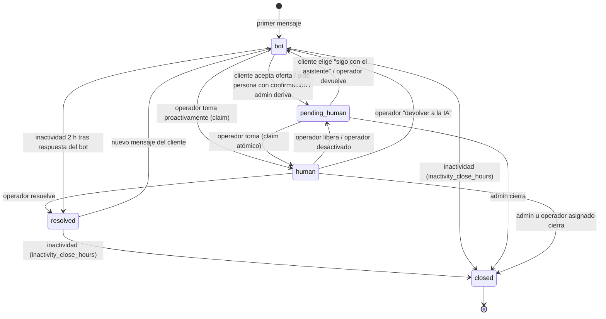

# 05 · Atención humana

[← Índice](RECORDAYA_CHATBOT_TECHNICAL_SPECIFICATION.md)

Todo es **[PROPUESTA]**.

---

## 16.1 Estados de la conversación

| Estado | Significado | ¿Responde la IA? | ¿Puede escribir un operador? |
| --- | --- | --- | --- |
| `bot` | Atendida por IA | Sí | Sí, tomándola primero (pasa a `human`) |
| `pending_human` | Pendiente de atención humana (en cola) | **No** (solo aviso de fuera de horario) | Tras tomarla |
| `human` | En atención humana, con `assigned_member_id` | **No** | Solo el asignado |
| `resolved` | Resuelta (por IA o humano). Sigue "abierta" para que un nuevo mensaje en < `inactivity_close_hours` continúe el mismo hilo | Sí, si llega un mensaje nuevo (vuelve a `bot`) | Tras tomarla |
| `closed` | Cerrada definitivamente; un mensaje nuevo abre otra conversación | — | No (solo lectura) |

Estado adicional evaluado y descartado: `waiting_customer` (operador esperando respuesta). Se modela con la marca derivada "último mensaje del agente" en la bandeja, sin multiplicar transiciones.

La oferta de derivación no es un estado: `handoff_offered_at` marca una oferta pendiente dentro de `bot` (si el cliente escribe otra cosa, la oferta caduca a los 30 min o con el siguiente turno del bot).

## 16.2 Transiciones



| # | Desde | Hacia | Disparador | Actor | Precondiciones | Efectos |
| --- | --- | --- | --- | --- | --- | --- |
| T1 | — | `bot` | Primer entrante sin conversación abierta | sistema | Chatbot activo | Crea conversación; evento `opened` |
| T2 | `bot` | `pending_human` | Botón `handoff:yes` o texto afirmativo con oferta vigente | cliente | `handoff_offered_at` < 30 min | `handoff_reason`, `handoff_requested_at`, `summary` (async), mensaje confirmado/fuera de horario; evento `handoff_accepted` |
| T3 | `bot` | `pending_human` | Admin/operador "Derivar a cola" | miembro | — | Igual que T2 con `operator_initiated` |
| T4 | `bot`/`pending_human`/`resolved` | `human` | "Tomar" | operador activo | `claim_conversation()` devuelve `true`; operador `is_available` y bajo `max_concurrent` (los admins pueden exceder) | Asignación, `unread_count=0`, evento `claimed` |
| T5 | `pending_human` | `bot` | Botón `handoff:no` o "Devolver a IA" | cliente / miembro | — | Mensaje "Sigo por aquí, ¿en qué más te ayudo?"; evento |
| T6 | `human` | `pending_human` | "Liberar" | asignado o admin | — | Cierra asignación (`released`) |
| T7 | `human` | `bot` | "Devolver a la IA" | asignado o admin | — | Cierra asignación (`returned_to_bot`), `consecutive_failures=0`; mensaje opcional al cliente |
| T8 | `human` | `resolved` | "Resolver" | asignado o admin | — | `resolved_by='human'`, `resolved_at`, cierra asignación, `closing_message` opcional |
| T9 | `bot` | `resolved` | Mantenimiento: 2 h sin entrantes tras respuesta del bot | sistema | — | `resolved_by='bot'` |
| T10 | `resolved` | `bot` | Nuevo entrante | cliente | — | Evento `reopened` |
| T11 | `bot`/`resolved` | `closed` | Mantenimiento: `inactivity_close_hours` | sistema | — | `closed_at` |
| T12 | cualquiera ≠ `closed` | `closed` | "Cerrar" | admin (o asignado si `human`) | — | Cierra asignación si existe |

Transiciones no listadas se rechazan en `state-machine.ts` (`ServiceError 409`).

## 16.3 Flujo de solicitud y confirmación

1. El cliente pide una persona, o el bot decide ofrecerla (fallos repetidos, tema sensible).
2. Bot envía `handoff_offer_message` con botones **[Sí, con una persona] [No, sigo aquí]** (`sendInteractiveButtons`). Si el envío interactivo falla, texto: "Responde *persona* para hablar con alguien del equipo".
3. Aceptación (`handoff:yes` o texto que coincida con «sí/persona/humano» con oferta vigente):
   - Transición T2; resumen generado en segundo plano (operación `summary`).
   - Si **en horario** y hay al menos un operador `is_available`: `handoff_confirmed_message`.
   - Si **fuera de horario** o sin operadores disponibles: `out_of_hours_message` con `{proximo_horario}` = próxima franja (`hours.ts: nextOpening(human_hours, timezone, now)` → «hoy a las 15:00», «mañana a las 9:00», «el lunes 24 a las 9:00»).
4. Rechazo: T5 en `bot`, la IA sigue.
5. **El cliente no repite su consulta:** el operador ve el historial completo, `handoff_reason`, `summary` y la última pregunta destacada.

## 16.4 Asignación de operador

- **MVP: cola compartida con toma manual ("tomar")**. Motivo: equipos pequeños, transparencia, sin necesidad de presencia en tiempo real.
- Exclusión mutua: `claim_conversation()` con `select … for update` (ver 03). Si dos operadores pulsan a la vez, uno recibe `true` y el otro el aviso "Otro operador ya tomó esta conversación".
- Envío de mensajes del operador: la Server Action `sendAgentMessageAction` verifica en la misma consulta que `assigned_member_id = miembro actual` y `status='human'`:
  ```sql
  insert into conversation_messages (…)
  select … where exists (select 1 from conversations
    where id = $conv and business_id = $biz and status = 'human' and assigned_member_id = $member)
  returning id;
  ```
  Si no se insertó ⇒ 409. Además `client_request_id` (uuid generado en el navegador) evita duplicados por doble clic o reintento.
- Reasignación por admin: `reassignConversationAction(conv, member)` = liberar + `claim_conversation(conv, biz, nuevo, admin)` en una transacción (función SQL `reassign_conversation`, T-09.4).
- Fase 2 (opcional): auto-asignación *round-robin* entre disponibles con menor carga.

## 16.5 Notificaciones

| Evento | Destinatarios | Canal MVP |
| --- | --- | --- |
| Nueva conversación en `pending_human` | Operadores y admins activos del negocio | Badge en la nav "Conversaciones (n)", sonido opcional y `Notification` del navegador (permiso del usuario) mientras el panel está abierto; polling 5 s |
| Nuevo mensaje en conversación `human` asignada | El asignado | Contador de no leídos + notificación del navegador |
| `pending_human` sin tomar > 10 min en horario | Admins | Banner en el panel |
| Fuera del panel | — | Fase 2 (D-07): email o plantilla WhatsApp al operador |

## 16.6 Disponibilidad y horarios

- `business_members.is_available` se activa/desactiva desde el header del panel (interruptor "Disponible"). Al cerrar sesión o tras 15 min sin polling (`last_seen_at`), el job de mantenimiento lo pone en `false`.
- `chatbot_settings.human_hours` define el horario de atención humana (independiente de la disponibilidad individual). "Hay atención ahora" = dentro de horario **y** ≥ 1 operador disponible.
- Aviso fuera de horario al cliente: como máximo 1 cada 12 h por conversación (`last_out_of_hours_notice_at`).

## 16.7 Ventana de 24 h de WhatsApp

- `conversations.last_inbound_at` determina si el operador puede enviar texto libre (`now - last_inbound_at < 24 h`).
- En el panel, el compositor muestra el tiempo restante; al vencer se deshabilita y aparece "Enviar plantilla para retomar" (D-08). El envío de la plantilla usa `sendTemplate` existente y se registra en `conversation_messages` (`sender_type='agent'`, `content_type='template'`).

## 16.8 Historial y contexto que ve el operador

- Línea de tiempo unificada: `conversation_messages` + recordatorios/confirmaciones de `messages` del mismo `business_id` y `to_phone` (solo lectura, con su estado ✓✓) + `conversation_events` legibles («Derivada por: el cliente pidió una persona», «Tomada por Ana»).
- Panel lateral: nombre y teléfono (formateado con `formatPhone`), cliente de turnos enlazado y próximo turno (enlace a `/panel/turnos/[id]`), motivo de derivación, resumen, fuentes usadas por el bot en cada respuesta (expandible), preguntas sin respuesta de esta conversación.

## 16.9 Cierre y reanudación del chatbot

- "Devolver a la IA" (T7) y "Resolver" (T8) desde la cabecera de la conversación.
- Al volver a `bot`, el siguiente mensaje del cliente lo responde la IA con el historial completo (incluye lo que dijo el operador).
- Mensaje al cliente al devolver: opcional, por defecto "Si necesitas algo más, el asistente sigue disponible por aquí."

## 16.10 Gestión de operadores

Ver permisos en [06-apis-e-interfaz.md §3](06-apis-e-interfaz.md#3-autenticación-y-permisos). Desactivar un miembro: sus conversaciones `human` pasan a `pending_human` (T6 con `member_disabled`) en la misma acción.

## 16.11 Restricciones y casos límite

| Caso | Comportamiento |
| --- | --- |
| El cliente escribe mientras está en `pending_human` | Se guarda, no responde la IA, aviso de fuera de horario según regla |
| El cliente responde «2» citando un recordatorio estando en `human` | Se cancela el turno (flujo actual); el operador ve el evento |
| El operador asignado cierra el navegador | La conversación sigue asignada; el admin puede reasignar; tras 15 min sin actividad su disponibilidad pasa a `false` pero **no** se libera automáticamente (evita perder contexto) |
| Dos pestañas del mismo operador | Ambas pueden enviar; `client_request_id` evita duplicados |
| El chatbot se desactiva con conversaciones en `pending_human`/`human` | Siguen en la bandeja; los nuevos entrantes van por la ruta `legacy` (como hoy) **y** se agregan a la conversación abierta para que el operador los vea |
| Conversación en `human` > 24 h sin actividad | Banner al admin; no se cierra automáticamente |
